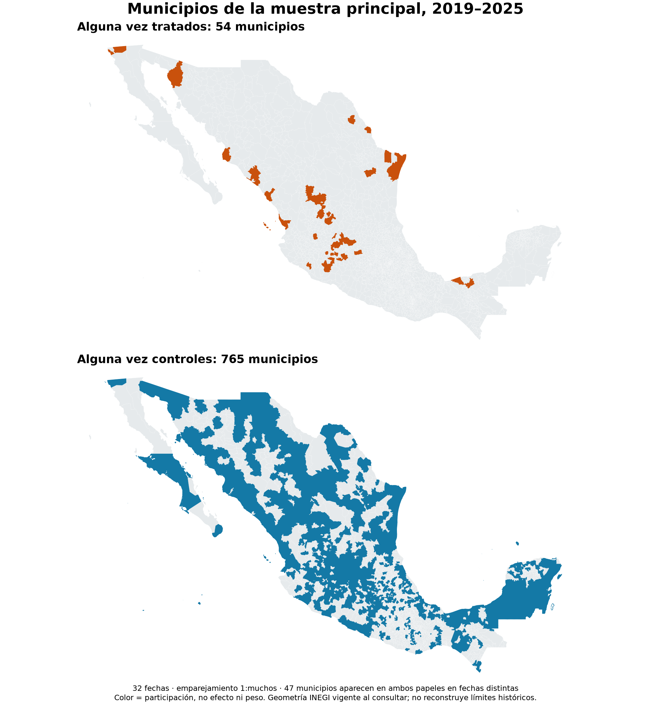

# Narcoataques y siniestros viales registrados

*Cambios en siniestros viales tras el inicio local de narcoataques en municipios mexicanos, 2019–2025*

**Eduardo Garcia Cortez · Clave única: 207480**

**Profesor: Mauricio Romero**

Inferencia Causal · ITAM · Noviembre de 2026

> Versión editable del [reporte en PDF](reporte.pdf).

## Resumen

¿Cambió el número de siniestros viales registrados cuando comenzó un narcoataque en un municipio? Para 77 pares municipio–inicio en México entre 2019 y 2025, se compara el cambio de los días 0 y 1 respecto a los días -28 a -8 con el de controles emparejados en las mismas fechas. Los registros disminuyeron más entre los tratados. La diferencia estimada fue de -0,348 siniestros por municipio y día (intervalo de confianza del 95 % [-0,834; 0,139], $p=0{,}155$, con agrupación por estado y fecha de inicio). El intervalo admite tanto una reducción como un aumento. Además, los grupos ya diferían en los días previos, lo que limita la atribución al ataque.

## 1. Contexto y motivación

Un bloqueo o la suspensión del transporte pueden reducir el número de viajes. Los desvíos y los cambios en la forma de conducir también pueden alterar el número de siniestros. En febrero de 2024, por ejemplo, la violencia contra transportistas interrumpió el servicio público en Chilpancingo (Amapola Periodismo, 2024). Para estudiar qué ocurre con los siniestros se utiliza la Estadística de Accidentes de Tránsito Terrestre en Zonas Urbanas y Suburbanas (ATUS), del Instituto Nacional de Estadística y Geografía (INEGI, 2026a). ATUS cubre vías no federales. Sus cifras dependen tanto de los hechos ocurridos como de su registro.

El objetivo es estimar el efecto promedio del tratamiento entre los tratados (ATT, por sus siglas en inglés). Para cada municipio con un inicio local documentado, interesa cuánto difieren sus registros de los que habría tenido en las mismas fechas sin el ataque. Cada par municipio–inicio recibe el mismo peso. El contraste principal abarca el día del inicio y el siguiente. Como el día 0 puede incluir horas anteriores al ataque, se trata de dos días naturales. Para examinar la duración del cambio se estudian también los días 2 a 6 y 7 a 13.

Bauernschuster y Rekers (2022) encontraron menos accidentes durante operativos alemanes de velocidad de un día y poca evidencia de que el descenso persistiera. Aunque el mecanismo difiere, ese antecedente motiva separar el cambio inmediato de su duración. En México, Dell (2015) documentó desplazamientos de rutas del narcotráfico y de la violencia. Si un ataque también altera la circulación en los municipios de control, la comparación pierde parte de su valor causal.

## 2. Datos

### Accidentes y exposición.

Se utilizan los microdatos definitivos de ATUS de 2019–2025 y los últimos meses de 2018 para revisar la cobertura previa (Instituto Nacional de Estadística y Geografía, 2025a, 2026a). En 2019–2025 hay 2 518 436 registros con fecha válida. Se conservan filas con atributos repetidos porque ATUS no proporciona un identificador único de accidente.

La muestra reúne 3 613 pares, de los cuales 77 son tratados y 3 536 son controles. Cada par identifica un municipio y una fecha de inicio. A los controles se les asigna la fecha de los tratados con los que se comparan. Hay 54 municipios tratados y 765 de control. Algunos participan en ambos grupos en fechas distintas (apéndice F). Los 31 episodios abarcan 32 fechas de inicio porque un mismo episodio puede llegar a distintos municipios en días diferentes.

Se identifica un episodio a partir de acciones coordinadas en al menos tres lugares dentro de 24 horas, con afectación del espacio público, comercios o transporte. Los lugares pueden pertenecer a municipios distintos. Para cada municipio se identifica el inicio local, aunque la violencia continúe después.

Tres agentes de inteligencia artificial (IA) reunieron noticias y comunicados para construir el catálogo de ataques. La cobertura de prensa es desigual y algunos casos aún requieren corroboración. Los incidentes menores o inciertos se conservan como antecedentes de exposición. El apéndice E documenta las fuentes y el apéndice C muestra cuánto cambian las estimaciones al excluir casos pendientes.

### Cobertura y ceros.

El diseño final se definió tras revisar un análisis preliminar. Para cada fecha de inicio, la selección principal usa información previa. Se exige al menos un registro con fecha válida en cada uno de los tres meses completos anteriores al mes del inicio. La continuidad del registro después del ataque solo interviene en un análisis de sensibilidad.

El resultado cuenta los siniestros publicados con fecha válida. Un cero indica que ATUS no contiene registros para ese municipio y día. Puede reflejar que no hubo siniestros o que los hubo y quedaron sin registrar. En el panel que evalúa la continuidad de la fuente se conservan los valores faltantes.

### Covariables y territorio.

La población procede de la Encuesta Intercensal 2015 (EIC) y de los Principales resultados por localidad (ITER) del Censo 2020. El Sistema Automatizado de Información Censal (SAIC) aporta el empleo de 2018 y 2023, y la estadística de Vehículos de Motor Registrados en Circulación (VMRC), los automóviles de 2018 a 2024. Las tasas por mil habitantes usan población anual del Consejo Nacional de Población (CONAPO). El Catálogo Único de Claves de Áreas Geoestadísticas Estatales, Municipales y Localidades (AGEEML) permite revisar los cambios territoriales (Consejo Nacional de Población, 2024; Instituto Nacional de Estadística y Geografía, 2015, 2021, 2025b, 2026c, 2026b).

Para cada inicio $t$ se toma la medición más reciente de cada variable anterior a $t-28$. Las fuentes se consultaron retrospectivamente. La regla fija cuándo se midió la variable, aunque el dato pudiera haberse publicado más tarde.

Antes del emparejamiento hay 84 pares tratados elegibles. Para 82 de ellos (97,6 %) se encuentra una fila de empleo y para 82 una de automóviles. El apéndice A distingue la disponibilidad de una fila de la de un valor utilizable y muestra cómo se llega a 77 tratados.

**Cuadro 1.** Comparabilidad previa de la muestra final

| Variable | Tratados: media (DE) | Controles 1:muchos | DME 1:muchos | DME 1:1 |
|:---|---:|---:|---:|---:|
| Población | 229 998,60 (243 845,81) | 225 349,52 (281 538,21) | 0,013 | 0,005 |
| Empleo / mil | 206,96 (95,98) | 197,32 (90,33) | 0,070 | 0,027 |
| Autos / mil | 208,63 (87,90) | 219,93 (97,55) | -0,082 | -0,023 |
| Siniestros previos | 2,05 (3,41) | 2,09 (3,45) | -0,011 | 0,012 |

La desviación estándar (DE) mide la dispersión entre pares. Las diferencias de medias estandarizadas (DME) usan la misma escala en ambos emparejamientos (apéndice A). Los siniestros previos de este cuadro son medias de los días -28 a -15, el periodo que se usa para elegir controles. La base de la regresión abarca del -28 al -8.

## 3. Estrategia empírica

### Estimando y base.

Sea $t$ la fecha de inicio local y sea $h$ el tramo de días relativos al inicio. $Y_{i,d}$ cuenta los siniestros publicados del municipio $i$ en la fecha calendario $d$. Para cada par, la base $B_{it}$ y el resultado medio $\bar Y_{ith}$ son

$$
B_{it}=\frac{1}{21}\sum_{k=-28}^{-8} Y_{i,t+k},
\qquad
\bar Y_{ith}=\frac{1}{|h|}\sum_{k\in h}Y_{i,t+k}.
$$

La base cubre las semanas -4, -3 y -2, con tres observaciones de cada día de la semana. $|h|$ cuenta los días del tramo. Para el inicio de Culiacán del 17 de octubre de 2019, la base va del 19 de septiembre al 9 de octubre. La semana -1 se reserva para examinar diferencias previas.

Sea $\mathrm{Treat}_{it}$ el indicador de par tratado y $A_{it}$ el de elegibilidad previa. Si $\bar Y_{ith}(1)$ y $\bar Y_{ith}(0)$ son los promedios diarios potenciales con y sin ataque, el objetivo es

$$
\tau_{\mathrm{ATT},h}=E[\bar Y_{ith}(1)-\bar Y_{ith}(0)\mid
\mathrm{Treat}_{it}=1,A_{it}=1,\text{soporte}].
$$

### Comparadores y pesos.

Para un inicio en $t$, solo pueden ser controles los municipios de estados sin un inicio local ese día. Para ambos grupos, entre los días -49 y -1 se excluye a los municipios con exposición documentada y a los estados con señales sin municipio identificable.

También se exige estabilidad territorial entre el comienzo de la base y la víspera del ataque. Puede entrar un control de un estado alcanzado por el mismo episodio en otra fecha (apéndice A). Por tanto, aún es posible que la violencia afecte a algún control.

Para elegir controles se compara la media de siniestros de los días -28 a -15 de cada candidato, $\bar Y_c$, con la del tratado, $\bar Y_i$. Se exige $(\bar Y_c+0.5)/(\bar Y_i+0.5)\in[0.5,2]$. También deben quedar entre la mitad y el doble del valor tratado, por separado, la población, el empleo por mil habitantes y los automóviles por mil habitantes. Cada tratado debe conservar al menos diez candidatos de cinco estados.

En el emparejamiento 1:muchos, cada tratado pesa uno y distribuye otro peso total de uno por igual entre sus controles. El 1:1 elige al candidato más cercano en las tres covariables. Si varios tratados eligen el mismo control, su peso en esa fecha suma todas las contribuciones.

### Regresión en el panel diario.

Cada par $i,t$ aporta una fila por fecha calendario $d$ de cada bloque $s$. Se define $\mathrm{Post}_s=1$ para el tramo analizado y $0$ para la base, también en los diagnósticos previos. Si $w_{it}$ es el peso del emparejamiento, cada día recibe $w_{it}/21$ en la base y $w_{it}/|h|$ en el tramo. Así, cada bloque aporta el mismo peso total por par y representa un promedio diario.

$$
\begin{aligned}
Y_{i,d}={}&\alpha_{ith}+\lambda_{th}\mathrm{Post}_s
  +\delta_{h,\operatorname{ds}(d)}\\
 &+\tau_{\mathrm{DD},h}(\mathrm{Treat}_{it}\times\mathrm{Post}_s)
  +(X_{it}'\gamma_h)\mathrm{Post}_s+\varepsilon_{ithsd}.
\end{aligned}
$$

El modelo incluye un efecto fijo para cada par ($\alpha_{ith}$) y permite que cada fecha de inicio tenga su propio cambio entre bloques ($\lambda_{th}$). El término $\delta_{h,\operatorname{ds}(d)}$ recoge el efecto del día de la semana de la fecha calendario $d$, con lunes como referencia. El coeficiente de **Tratado × Después**, $\tau_{\mathrm{DD},h}$, mide cuánto más o menos cambió el promedio diario de los tratados que el de sus controles.

Dentro de cada fecha de inicio, ambos grupos comparten calendario. La variación diaria de los conteos permite estimar seis efectos de día de la semana. Su ajuste es común a los dos grupos y se cancela en la diferencia de cambios del modelo principal (apéndice D).

El modelo principal $M_0$ da el mismo peso a cada tratado. Si se cumplen los supuestos de identificación, su diferencia de cambios estima el ATT del tramo. Sobre la misma muestra y con los mismos pesos, $M_1$ añade la interacción del logaritmo de la población con Después. $M_2$ incorpora también el empleo por mil habitantes y $M_3$ los automóviles por mil, en ambos casos en interacción con Después.

### Identificación y sesgo.

Al restar la base a cada par se eliminan diferencias de nivel constantes. Al restar después el cambio de los controles se descuenta la variación común a cada fecha. La interpretación causal exige que, sin el ataque, los registros de ambos grupos hubieran evolucionado en paralelo. También exige que el ataque no se anticipara en la base, que las exposiciones más antiguas ya no influyeran y que la violencia no afectara a los controles.

El emparejamiento acerca a los grupos en características observadas. Las diferencias previas y el placebo permiten detectar problemas con la comparación, aunque ningún resultado de esas pruebas demuestra paralelismo (Roth, 2022). Además, los episodios pueden repetirse, de modo que el tratamiento se define por su inicio local y puede ocurrir más de una vez en un municipio (Dube et al., 2025).

### 3.1. Incertidumbre y selección posterior

La inferencia principal agrupa por estado y fecha de inicio. Admite dependencia entre municipios de un estado a lo largo del tiempo y entre municipios que comparten la fecha de inicio. También se calcula el intervalo con agrupación solo por estado, sobre la misma estimación.

De los 32 estados, 14 aportan tratados. Para medir su influencia se repite el cálculo tras omitir un estado a la vez. El apéndice D presenta las estimaciones y la corrección de muestra finita (MacKinnon et al., 2023a, 2023b).

Para estudiar la duración se conserva la muestra principal. Una segunda muestra exige continuidad del registro del día -28 al +13 y ausencia de otra exposición hasta +14. El episodio inicial puede continuar. Esta selección depende de lo ocurrido después del ataque y cambia la población estudiada.

## 4. Resultados

### Siniestros registrados en los días 0 y 1.

Entre la base y los días 0 y 1, la media ponderada de siniestros registrados pasó de 2,050 a 1,656 entre los tratados y de 2,094 a 2,048 entre sus controles. Con las medias sin redondear, la diferencia de cambios es de -0,348 siniestros registrados por municipio y día. El intervalo de confianza (IC) del 95 % por estado y fecha de inicio va de -0,834 a 0,139 ($p=0{,}155$). Los datos son compatibles tanto con una reducción como con un aumento.

Con agrupación solo por estado, el intervalo es más estrecho, de -0,635 a -0,060. La estimación puntual equivale a -0,094 desviaciones estándar del conteo diario previo de los tratados. El efecto mínimo detectable (MDE, por sus siglas en inglés) es de 0,690 siniestros por municipio y día con potencia del 80 % en una prueba bilateral al 5 %. Los ajustes progresivos apenas cambian la estimación puntual (cuadro 2). El cuadro B1 presenta los demás tramos.

**Cuadro 2.** Días 0 y 1. Regresiones con ajuste progresivo en la muestra principal

| Variable | $M_0$ | $M_1$ | $M_2$ | $M_3$ |
| :--- | ---: | ---: | ---: | ---: |
| Tratado × Después | -0,348<br>(0,239)<br>[-0,834; 0,139]<br>$p=0{,}155$ | -0,341<br>(0,239)<br>[-0,830; 0,147]<br>$p=0{,}164$ | -0,341<br>(0,244)<br>[-0,839; 0,156]<br>$p=0{,}172$ | -0,343<br>(0,246)<br>[-0,844; 0,158]<br>$p=0{,}173$ |
| Logaritmo de la población × Después | — | -0,077<br>(0,080)<br>[-0,241; 0,086]<br>$p=0{,}342$ | -0,076<br>(0,078)<br>[-0,236; 0,083]<br>$p=0{,}336$ | -0,075<br>(0,076)<br>[-0,229; 0,079]<br>$p=0{,}328$ |
| Empleo por mil × Después | — | — | -0,000026<br>(0,001025)<br>[-0,002116; 0,002063]<br>$p=0{,}980$ | 0,000006<br>(0,001053)<br>[-0,002141; 0,002153]<br>$p=0{,}996$ |
| Automóviles por mil × Después | — | — | — | -0,000117<br>(0,000725)<br>[-0,001595; 0,001362]<br>$p=0{,}873$ |

Cada celda presenta el coeficiente, el error estándar entre paréntesis, el IC del 95 % y el valor $p$ bilateral. La agrupación es por estado y fecha de inicio, con 31 grados de libertad. Los cuatro modelos usan los mismos 3 613 pares, incluidos 77 tratados en 32 fechas.

Con el emparejamiento 1:1, el contraste inmediato es de -0,311 siniestros registrados por municipio y día (IC [-0,820; 0,198]). Elegir un solo control por tratado conserva el signo y un intervalo amplio (cuadro B2).

### Evolución diaria y diagnósticos previos.

La figura 1a sitúa el contraste en su escala original. Cada punto es un promedio de los registros de ese día en los municipios del grupo.

**Figura 1a. Conteos diarios observados de tratados y controles.** Medias con los pesos del emparejamiento 1:muchos. El sombreado cubre los 21 días de la base, del -28 al -8. La línea vertical marca el inicio local.


**Figura 1b. Cambios diarios de tratados y controles respecto a la base.** A cada par se le resta su promedio de los días -28 a -8. Las líneas muestran la media ponderada de esos cambios por grupo entre los días -7 y +13. La línea vertical marca el inicio local.


La distancia vertical entre las líneas de la figura 1b, tratados menos controles, coincide con el coeficiente diario de $M_0$ con emparejamiento 1:muchos. La figura 1c muestra esa diferencia y su incertidumbre para los dos emparejamientos.

**Figura 1c. Diferencia de cambios por día y por emparejamiento.** Los puntos son coeficientes diarios de $M_0$ respecto a la base de los días -28 a -8. Las barras representan intervalos puntuales del 95 % por estado y fecha de inicio. Cada intervalo corresponde a un solo día.


Con 1:muchos, los días -3 y -2 ya presentan diferencias de -0,451 y -0,533 siniestros registrados por municipio y día. Ambos intervalos puntuales quedan por debajo de cero. Para la semana -1 en su conjunto, la diferencia es de -0,157 (IC [-0,316; 0,002]). La evolución previa resta credibilidad a la interpretación causal del contraste inmediato.

Después del inicio, la diferencia puntual es de -0,224 el día 0 y de -0,471 el día 1. Ambos días tienen el mismo peso en el contraste principal. Los intervalos de la figura describen la incertidumbre de cada día por separado, sin ajuste por el número de días examinados.

La prueba conjunta de Wald contrasta si las diferencias de las semanas -4, -3 y -1 respecto a la base son cero. Con 1:muchos se obtiene $p=0{,}035$ al agrupar por estado y $p=0{,}081$ al agrupar por estado y fecha de inicio. La decisión al 5 % depende de la agrupación. La segunda prueba deja abierta la posibilidad de diferencias previas. El cuadro D2 explica las tres restricciones.

El placebo traslada cada inicio 28 días atrás y vuelve a seleccionar y emparejar municipios. Con 81 tratados en 38 fechas ficticias, el contraste inmediato es de -0,191 siniestros registrados por municipio y día (IC [-0,569; 0,188]). En el placebo de los días 2 a 6 y de la semana 0, los intervalos quedan por debajo de cero solo con agrupación estatal (cuadro B3). El placebo tampoco despeja las dudas sobre la comparabilidad previa.

### Persistencia y calendario.

En la muestra principal, la diferencia de cambios es de -0,145 siniestros registrados por municipio y día en los días 2 a 6 (IC [-0,353; 0,063]) y de -0,079 en los días 7 a 13 (IC [-0,317; 0,158]). Ambos intervalos admiten descensos y aumentos. El día +11 presenta un intervalo puntual por debajo de cero con ambos emparejamientos, pero un día aislado no establece la duración del cambio. El cuadro B2 compara las muestras y el apéndice G examina las diferencias por horario y gravedad.

El calendario puede alterar la circulación (Cámara de Diputados, 2025; Secretaría de Educación de Veracruz, 2026). Al excluir inicios con un feriado de la Ley Federal del Trabajo (LFT) o un receso de la Secretaría de Educación Pública (SEP) en el día 0 o 1, quedan 25 tratados y 15 fechas. El contraste inmediato es -0,595 (IC [-1,288; 0,098]). Una exclusión distinta, la de cinco fechas revisadas en la auditoría, deja 56 tratados en 27 fechas y arroja -0,426 (IC [-0,816; -0,036]). Cada exclusión cambia los episodios representados (apéndice C).

## 5. Conclusión y validez externa

En los 77 pares municipio–inicio documentados en México entre 2019 y 2025, el conteo diario de siniestros registrados disminuyó más entre los tratados que entre sus controles durante el día del inicio y el siguiente. La diferencia estimada es de -0,348 siniestros por municipio y día (IC del 95 % [-0,834; 0,139], $p=0{,}155$, por estado y fecha de inicio). El intervalo admite desde una reducción de 0,834 hasta un aumento de 0,139. Los tramos de los días 2 a 6 y 7 a 13 tampoco permiten precisar cuánto duró el cambio.

Los grupos ya diferían antes del inicio y la precisión depende de cómo se agrupan los errores. Por ello, la comparación no basta para atribuir la diferencia al narcoataque. La cobertura desigual del catálogo limita la extrapolación a otros episodios. ATUS registra hechos en vías no federales y carece de un denominador de viajes. Para distinguir un cambio en la seguridad vial de uno en la circulación o en la captación harían falta, además, datos de movilidad y de atención de emergencias.

## Referencias

Amapola Periodismo. (2024, 8 de febrero). *Chilpancingo: tres días de parálisis por la violencia*. <https://amapolaperiodismo.com/2024/02/08/chilpancingo-tres-dias-de-paralisis-por-la-violencia/>

Bauernschuster, S., & Rekers, R. (2022). Speed limit enforcement and road safety. *Journal of Public Economics*, *210*, Artículo 104663. <https://doi.org/10.1016/j.jpubeco.2022.104663>

Cámara de Diputados. (2025). *Ley Federal del Trabajo, artículo 74*. <https://www.ordenjuridico.gob.mx/Documentos/Federal/html/wo125151.html>

Consejo Nacional de Población. (2024). *Reconstrucción y proyecciones de la población de los municipios de México, 1990–2040*. <https://conapo.segob.gob.mx/work/models/CONAPO/pry23/DBMun/00_Republica_mexicana.zip>

Dell, M. (2015). Trafficking networks and the Mexican Drug War. *American Economic Review*, *105*(6), 1738–1779. <https://doi.org/10.1257/aer.20121637>

Dube, A., Girardi, D., Jordà, Ò., & Taylor, A. M. (2025). A local projections approach to difference-in-differences. *Journal of Applied Econometrics*, *40*(7), 741–758. <https://doi.org/10.1002/jae.70000>

Instituto Nacional de Estadística y Geografía. (2015). *Encuesta Intercensal 2015: tabulados de población y vivienda*. <https://www.inegi.org.mx/programas/intercensal/2015/>

Instituto Nacional de Estadística y Geografía. (2021). *Censo de Población y Vivienda 2020: principales resultados por localidad (ITER)*. <https://www.inegi.org.mx/programas/ccpv/2020/>

Instituto Nacional de Estadística y Geografía. (2025a). *Estadística de Accidentes de Tránsito Terrestre en Zonas Urbanas y Suburbanas, diccionario de datos*. <https://inegi.org.mx/rnm/index.php/catalog/1115/data-dictionary/F1>

Instituto Nacional de Estadística y Geografía. (2025b). *Sistema Automatizado de Información Censal (SAIC)*. <https://www.inegi.org.mx/app/saic/>

Instituto Nacional de Estadística y Geografía. (2026a). *Accidentes de Tránsito Terrestre en Zonas Urbanas y Suburbanas*. <https://www.inegi.org.mx/programas/accidentes/>

Instituto Nacional de Estadística y Geografía. (2026b). *Catálogo Único de Claves de Áreas Geoestadísticas Estatales, Municipales y Localidades*. <https://www.inegi.org.mx/app/ageeml/>

Instituto Nacional de Estadística y Geografía. (2026c). *Vehículos de Motor Registrados en Circulación (VMRC)*. <https://www.inegi.org.mx/programas/vehiculosmotor/>

MacKinnon, J. G., Nielsen, M. Ø., & Webb, M. D. (2023a). Cluster-robust inference: A guide to empirical practice. *Journal of Econometrics*, *232*(2), 272–299. <https://doi.org/10.1016/j.jeconom.2022.04.001>

MacKinnon, J. G., Nielsen, M. Ø., & Webb, M. D. (2023b). Fast and reliable jackknife and bootstrap methods for cluster-robust inference. *Journal of Applied Econometrics*, *38*(5), 671–694. <https://doi.org/10.1002/jae.2969>

Roth, J. (2022). Pretest with caution: Event-study estimates after testing for parallel trends. *American Economic Review: Insights*, *4*(3), 305–322. <https://doi.org/10.1257/aeri.20210236>

Secretaría de Educación de Veracruz. (2026). *Calendarios escolares históricos de educación básica*. <https://www.sev.gob.mx/educacion-basica/calendario-escolar/>

## Apéndice A. Fuentes, emparejamiento y balance

Los cuadros A1 a A3 siguen a los municipios desde el catálogo hasta la muestra final. Los cuadros A4 y A5 muestran qué cambia al elegir controles y al añadir covariables a la regresión.

### Detalles de medición y emparejamiento.

La serie de automóviles de Colima ilustra por qué importa la fecha de medición. El dato etiquetado como 2023 corresponde al 30 de abril de 2024 y utiliza como denominador la población al 1 de julio de 2024. El análisis solo lo admite si ambas fechas preceden a $t-28$. Los valores confidenciales y los faltantes se distinguen de los ceros observados.

En Morelia, para el inicio del 23 de abril de 2025, doce municipios cumplen todos los filtros. El método 1:muchos los conserva a todos. El método 1:1 elige el de menor distancia euclidiana entre los logaritmos en base dos de las razones candidato/tratado en población, empleo por mil y automóviles por mil. La exclusión geográfica se aplica fecha por fecha. Por ejemplo, el 10 de agosto de 2022 hubo diez controles de Jalisco, donde el mismo episodio había comenzado en otros municipios el día anterior.

### Fuentes y selección de la muestra.

**Cuadro A1.** Disponibilidad de las fuentes para los pares elegibles

| Fuente    |       Rol | Unidas / elegibles |     % | Valor utilizable / elegibles |
|:----------|----------:|-------------------:|------:|-----------------------------:|
| EIC 2015  |  Tratados |                7/7 | 100,0 |                          7/7 |
| ITER 2020 |  Tratados |              75/77 |  97,4 |                        75/77 |
| EIC 2015  | Controles |        3 411/3 453 |  98,8 |                  3 411/3 453 |
| ITER 2020 | Controles |      20 814/20 981 |  99,2 |                20 814/20 981 |
| SAIC      |  Tratados |              82/84 |  97,6 |                        82/84 |
| SAIC      | Controles |      24 230/24 434 |  99,2 |                24 139/24 434 |
| VMRC      |  Tratados |              82/84 |  97,6 |                        82/84 |
| VMRC      | Controles |      24 092/24 434 |  98,6 |                24 002/24 434 |

Cada denominador cuenta los pares elegibles antes de exigir datos completos. La tercera columna cuenta las filas que se pudieron enlazar y la última, las que aportaron un valor utilizable. El cuadro A2 verifica que las tasas tengan un denominador de población del año del numerador. Para el territorio se consultó un inventario de cambios municipales y se comprobó la estabilidad del perímetro entre ambas fechas.

**Cuadro A2.** Denominadores de población y estabilidad territorial

| Operación | Numerador / denominador | % | Universo |
|:---|---:|---:|---:|
| CONAPO en SAIC | 3 613/3 613 | 100,0 | Pares de la muestra final |
| CONAPO en VMRC | 3 613/3 613 | 100,0 | Pares de la muestra final |
| AGEEML: perímetro estable | 106 554/106 554 | 100,0 | Municipio-fechas candidatos |

**Cuadro A3.** Selección de los pares tratados, filtro por filtro

| Paso, orden jerárquico              | Trat. restantes | Trat. excluidos |
|:------------------------------------|----------------:|----------------:|
| Candidatos del catálogo             |             108 |               — |
| Sin historia de cobertura           |              94 |              14 |
| Exposición previa, tras cobertura   |              84 |              10 |
| Territorio, tras filtros anteriores |              84 |               0 |
| Covariables faltantes               |              82 |               2 |
| Controles completos insuficientes   |              82 |               0 |
| Calibre individual sin soporte      |              82 |               0 |
| Población sin soporte               |              78 |               4 |
| Empleo sin soporte                  |              77 |               1 |
| Autos sin soporte                   |              77 |               0 |

De los 108 pares del catálogo, 84 cumplen los requisitos de cobertura, exposición previa y territorio. El filtro de cobertura descarta también historiales con fechas inválidas en los meses de referencia. De los 84 elegibles, dos carecen de alguna covariable. Otros cinco quedan fuera porque los filtros de población o empleo dejan menos de diez candidatos o menos de cinco estados. Así se obtienen los 77 tratados del análisis principal.

**Cuadro A4.** Diferencias de medias estandarizadas con los mismos 77 tratados

| Variable           | Antes de emparejar | 1:muchos |    1:1 |
|:-------------------|-------------------:|---------:|-------:|
| Población          |              0,274 |    0,013 |  0,005 |
| Empleo / mil       |              0,269 |    0,070 |  0,027 |
| Autos / mil        |             -0,021 |   -0,082 | -0,023 |
| Siniestros previos |              0,175 |   -0,011 |  0,012 |

Antes del emparejamiento, todos los controles con datos completos reciben el mismo peso dentro de cada fecha. Las tres columnas usan la misma escala para cada variable, la raíz del promedio de las varianzas de los dos grupos en la referencia con el filtro de siniestros previos. Con 1:muchos se acortan las diferencias en población, empleo y siniestros previos. La diferencia en automóviles aumenta en valor absoluto de 0,021 a 0,082. El balance describe solo las variables observadas.

**Cuadro A5.** Diferencia de cambios en los días 0 y 1 según la selección de controles y el modelo

| Controles | Modelo | Trat. | $N$ | Estimación e IC por estado y fecha |
| :--- | ---: | ---: | ---: | ---: |
| Completos, calibre | $M_0$ | 82 | 13 977 | -0,393 [-0,857; 0,071] |
| Completos, calibre | $M_1$ | 82 | 13 977 | -0,361 [-0,827; 0,104] |
| Completos, calibre | $M_2$ | 82 | 13 977 | -0,359 [-0,820; 0,102] |
| Completos, calibre | $M_3$ | 82 | 13 977 | -0,364 [-0,841; 0,113] |
| Sin emparejar | $M_0$ | 77 | 22 561 | -0,385 [-0,820; 0,050] |
| Sin emparejar | $M_1$ | 77 | 22 561 | -0,298 [-0,623; 0,027] |
| Sin emparejar | $M_2$ | 77 | 22 561 | -0,298 [-0,623; 0,027] |
| Sin emparejar | $M_3$ | 77 | 22 561 | -0,310 [-0,656; 0,035] |
| 1:muchos | $M_0$ | 77 | 3 613 | -0,348 [-0,834; 0,139] |
| 1:muchos | $M_1$ | 77 | 3 613 | -0,341 [-0,830; 0,147] |
| 1:muchos | $M_2$ | 77 | 3 613 | -0,341 [-0,839; 0,156] |
| 1:muchos | $M_3$ | 77 | 3 613 | -0,343 [-0,844; 0,158] |
| 1:1 | $M_0$ | 77 | 154 | -0,311 [-0,820; 0,198] |
| 1:1 | $M_1$ | 77 | 154 | -0,312 [-0,829; 0,206] |
| 1:1 | $M_2$ | 77 | 154 | -0,315 [-0,840; 0,210] |
| 1:1 | $M_3$ | 77 | 154 | -0,320 [-0,858; 0,217] |

Dentro de cada selección, $M_0$ a $M_3$ usan los mismos pares y pesos. La primera selección exige datos completos y el filtro de siniestros previos. La segunda conserva los 77 tratados finales y utiliza todos los controles con datos completos, con peso uniforme dentro de cada fecha. Los dos emparejamientos también conservan esos 77 tratados. Los 77 pares de control del 1:1 pertenecen al conjunto de 3 536 del 1:muchos, aunque los pesos difieren.

## Apéndice B. Resultados por periodo y placebo

**Cuadro B1.** Diferencia de cambios por periodo en la muestra principal, emparejamiento 1:muchos

| Periodo | $\hat\tau$ (EE) | IC del 95 % | $\hat\tau/\sigma$ | MDE |
| :--- | ---: | ---: | ---: | ---: |
| Día 0 | -0,224 (0,318) | [-0,872; 0,424] | -0,061 | 0,919 |
| Día 1 | -0,471 (0,227) | [-0,934; -0,008] | -0,128 | 0,657 |
| Días 0–1 | -0,348 (0,239) | [-0,834; 0,139] | -0,094 | 0,690 |
| Días 2–6 | -0,145 (0,102) | [-0,353; 0,063] | -0,039 | 0,295 |
| Sem. 0 | -0,203 (0,120) | [-0,448; 0,042] | -0,055 | 0,347 |
| Sem. +1 | -0,079 (0,116) | [-0,317; 0,158] | -0,022 | 0,336 |

En los 3 613 pares del modelo principal, $\hat\tau$ se expresa en siniestros registrados por municipio y día. El error estándar (EE), el intervalo de confianza (IC) y el efecto mínimo detectable (MDE) usan la misma agrupación por estado y fecha de inicio. Para expresar el coeficiente en desviaciones estándar se divide por $\sigma=3{,}68$, la desviación muestral de los conteos diarios de los tratados en los 21 días de la base. La semana 0 comprende los días 0 a 6 y la semana +1, los días 7 a 13.

**Cuadro B2.** Diferencia de cambios en tres periodos según la selección y el emparejamiento

| Selección | Método | Trat. | Días 0–1 | Días 2–6 | Sem. +1 |
| :--- | ---: | ---: | ---: | ---: | ---: |
| Principal | 1:muchos | 77 | -0,348 [-0,834; 0,139] | -0,145 [-0,353; 0,063] | -0,079 [-0,317; 0,158] |
| Principal | 1:1 | 77 | -0,311 [-0,820; 0,198] | -0,108 [-0,425; 0,208] | -0,181 [-0,572; 0,210] |
| Aislamiento posterior | 1:muchos | 69 | -0,444 [-0,968; 0,080] | -0,083 [-0,266; 0,100] | -0,094 [-0,358; 0,169] |
| Aislamiento posterior | 1:1 | 69 | -0,330 [-0,879; 0,219] | -0,080 [-0,422; 0,263] | -0,222 [-0,649; 0,206] |
| Placebo 28 días antes | 1:muchos | 81 | -0,191 [-0,569; 0,188] | -0,136 [-0,306; 0,033] | -0,032 [-0,148; 0,085] |
| Placebo 28 días antes | 1:1 | 81 | -0,460 [-0,990; 0,070] | -0,144 [-0,458; 0,170] | -0,059 [-0,282; 0,164] |

Los intervalos del 95 % se agrupan por estado y fecha de inicio. Exigir continuidad del registro del día -28 al +13 y ausencia de otra exposición hasta +14 reduce los tratados de 77 a 69. El placebo reconstruye la muestra para la fecha ficticia y reúne 81 tratados. Las comparaciones entre filas reflejan también estos cambios de composición.

**Cuadro B3.** Diferencia de cambios tras el inicio ficticio situado 28 días antes

| Horizonte | 1:muchos, IC doble | $p$ doble | $p$ estatal | 1:1, IC doble | $p$ doble | $p$ estatal |
| :--- | ---: | ---: | ---: | ---: | ---: | ---: |
| Día 0 | -0,244 [-0,653; 0,165] | 0,233 | 0,121 | -0,447 [-1,095; 0,200] | 0,168 | 0,150 |
| Día 1 | -0,138 [-0,616; 0,341] | 0,562 | 0,322 | -0,472 [-1,105; 0,161] | 0,138 | 0,090 |
| Días 0–1 | -0,191 [-0,569; 0,188] | 0,312 | 0,140 | -0,460 [-0,990; 0,070] | 0,086 | 0,065 |
| Días 2–6 | -0,136 [-0,306; 0,033] | 0,112 | 0,015 | -0,144 [-0,458; 0,170] | 0,357 | 0,266 |
| Sem. 0 | -0,152 [-0,328; 0,023] | 0,087 | 0,022 | -0,234 [-0,509; 0,041] | 0,092 | 0,061 |
| Sem. +1 | -0,032 [-0,148; 0,085] | 0,583 | 0,397 | -0,059 [-0,282; 0,164] | 0,590 | 0,584 |

«Doble» indica agrupación por estado y por fecha de inicio. En el placebo 1:muchos, los días 2 a 6 y la semana 0 dan valores $p$ de 0,015 y 0,022 con agrupación estatal, y de 0,112 y 0,087 con agrupación doble. El contraste inmediato es impreciso en ambas. Este diagnóstico permite ver qué diferencias aparecen incluso antes de los inicios documentados.

## Apéndice C. Sensibilidad a las exclusiones y al calendario

**Cuadro C1.** Diferencia de cambios en los días 0 y 1 al excluir fechas o casos

| Exclusión / muestra | Método | Trat. | Fechas | Estimación e IC por estado y fecha |
| :--- | ---: | ---: | ---: | ---: |
| Principal | 1:muchos | 77 | 32 | -0,348 [-0,834; 0,139] |
| Principal | 1:1 | 77 | 32 | -0,311 [-0,820; 0,198] |
| Sin las cinco fechas de auditoría | 1:muchos | 56 | 27 | -0,426 [-0,816; -0,036] |
| Sin las cinco fechas de auditoría | 1:1 | 56 | 27 | -0,431 [-0,799; -0,062] |
| Sin feriados LFT | 1:muchos | 73 | 30 | -0,431 [-0,949; 0,087] |
| Sin feriados LFT | 1:1 | 73 | 30 | -0,308 [-0,842; 0,227] |
| Sin LFT ni recesos SEP | 1:muchos | 25 | 15 | -0,595 [-1,288; 0,098] |
| Sin LFT ni recesos SEP | 1:1 | 25 | 15 | -0,607 [-1,307; 0,094] |
| Sin dos tratados pendientes | 1:muchos | 75 | 32 | -0,354 [-0,851; 0,142] |
| Sin dos tratados pendientes | 1:1 | 75 | 32 | -0,322 [-0,837; 0,193] |
| Sin cuatro casos pendientes | 1:muchos | 74 | 32 | -0,354 [-0,857; 0,150] |
| Sin cuatro casos pendientes | 1:1 | 74 | 32 | -0,318 [-0,840; 0,204] |
| Sin dos señales en controles | 1:muchos | 77 | 32 | -0,348 [-0,834; 0,139] |
| Sin dos señales en controles | 1:1 | 77 | 32 | -0,289 [-0,812; 0,234] |

La auditoría identifica cinco fechas concretas para una exclusión conjunta (última columna del cuadro C3). La exclusión por calendario aplica otra regla a los días 0 y 1 de todas las cohortes. Distingue los feriados de la LFT de los recesos, talleres y suspensiones del calendario escolar. Un domingo por sí solo no activa la exclusión.

La revisión de casos retira juntos a Chilchota (14/07/2021) y Contepec (23/04/2025), ambos en Michoacán. Una segunda revisión retira además a San Fernando, Tamaulipas (30/04/2023), y Huaniqueo, Michoacán (23/04/2025). Este último ya estaba fuera por los requisitos previos, de modo que quedan 74 tratados. Para los controles se revisaron señales en Centro, Tabasco (1 y 2/04/2025), y en Coatzacoalcos, Veracruz (20/08/2022). Si una señal cae entre $t-49$ y $t+14$, se retira ese control y se calculan de nuevo los emparejamientos y pesos. Esta sensibilidad admite información posterior al inicio. El cotejo documental cubrió 27 pares en cuatro fechas y deja abierta la posibilidad de otras exposiciones.

**Cuadro C2.** Composición de las muestras por escenario y por emparejamiento

| Escenario | Tratados | Controles 1:muchos | Controles 1:1 | Fechas | Episodios |
| :--- | ---: | ---: | ---: | ---: | ---: |
| Principal | 77 | 3 536 | 77 | 32 | 31 |
| Aislamiento posterior | 69 | 3 038 | 69 | 30 | 29 |
| Placebo 28 días antes | 81 | 3 838 | 81 | 38 | 37 |
| Sin las cinco fechas de auditoría | 56 | 2 842 | 56 | 27 | 26 |
| Sin feriados LFT | 73 | 3 320 | 73 | 30 | 29 |
| Sin LFT ni recesos SEP | 25 | 1 314 | 25 | 15 | 15 |
| Sin dos tratados pendientes | 75 | 3 457 | 75 | 32 | 31 |
| Sin cuatro casos pendientes | 74 | 3 283 | 74 | 32 | 31 |
| Sin dos señales en controles | 77 | 3 533 | 77 | 32 | 31 |

**Cuadro C3.** Fechas de inicio, tratados y coincidencias con el calendario

| Inicio     | Trat. | LFT en días 0–1 | SEP en días 0–1 | Cinco fechas |
|:-----------|------:|----------------:|----------------:|-------------:|
| 2019-10-17 |     1 |              No |              No |           No |
| 2019-11-30 |     1 |              No |              No |           No |
| 2019-12-31 |     1 |              Sí |              Sí |           Sí |
| 2020-03-10 |     3 |              No |              No |           No |
| 2020-06-19 |     1 |              No |              Sí |           No |
| 2020-06-20 |     5 |              No |              Sí |           No |
| 2020-12-04 |     1 |              No |              No |           No |
| 2021-05-28 |     2 |              No |              No |           No |
| 2021-07-14 |     2 |              No |              Sí |           No |
| 2022-03-13 |     1 |              No |              No |           No |
| 2022-08-09 |     5 |              No |              Sí |           No |
| 2022-08-10 |     1 |              No |              Sí |           No |
| 2022-08-12 |     2 |              No |              Sí |           No |
| 2022-08-18 |     1 |              No |              Sí |           No |
| 2022-08-27 |     2 |              No |              Sí |           No |
| 2022-11-28 |     1 |              No |              No |           No |
| 2022-12-04 |     2 |              No |              No |           No |
| 2023-01-05 |     3 |              No |              Sí |           Sí |
| 2023-02-19 |     1 |              No |              No |           No |
| 2023-04-09 |     2 |              No |              Sí |           Sí |
| 2023-04-30 |     3 |              Sí |              No |           No |
| 2023-08-27 |     3 |              No |              Sí |           No |
| 2023-09-22 |     1 |              No |              No |           No |
| 2023-09-27 |     2 |              No |              No |           No |
| 2023-12-22 |     1 |              No |              Sí |           No |
| 2024-01-07 |     5 |              No |              Sí |           Sí |
| 2024-05-05 |     1 |              No |              No |           No |
| 2024-10-04 |     3 |              No |              No |           No |
| 2025-04-23 |    10 |              No |              Sí |           Sí |
| 2025-07-26 |     5 |              No |              Sí |           No |
| 2025-09-28 |     1 |              No |              No |           No |
| 2025-10-03 |     4 |              No |              No |           No |

Cada fila agrupa a los tratados con la misma fecha de inicio. Se consultaron el artículo 74 de la LFT y el calendario nacional de educación básica, con los fines de semana contiguos al receso hasta la reanudación de clases. Las adaptaciones de cada institución pueden diferir. Ninguna de las 32 fechas coincide en los días 0 o 1 con una jornada electoral ordinaria.

## Apéndice D. Inferencia, precisión y sensibilidad por estado

La varianza robusta por conglomerados (CRV1) aplica la corrección de muestra finita $\frac{G}{G-1}\frac{N-1}{N-F-K}$. Aquí $N$ cuenta pares municipio–inicio, $F$ cuenta fechas de inicio y $K$ es el rango de los regresores del contraste después de absorber los efectos de fecha. En la agrupación estatal, $G$ cuenta estados. En la agrupación doble se suman las covarianzas por estado y por fecha y se resta la de su intersección. Se toma como $G$ el menor de los dos recuentos y se calculan los intervalos con una distribución $t$ con $G-1$ grados de libertad.

### Del conteo diario al contraste entre bloques.

Dentro de cada fecha de inicio y bloque, se resta a cada indicador de día de la semana su media. Esos indicadores centrados suman cero para cada par y bloque. La variación diaria permite así estimar seis efectos de día de la semana por separado de los regresores que distinguen los bloques. Con esos efectos se ajustan las medias diarias de la base y del periodo bajo estudio.

Dentro de una fecha de inicio, el ajuste por día de la semana es común a todos los pares y queda absorbido por el efecto de fecha en la diferencia entre bloques. Las desviaciones diarias respecto a cada media de bloque suman cero dentro del par y de cada conglomerado. Por ello, la corrección de muestra finita del contraste utiliza los pares y el rango $F+K$. En los días 0 y 1 hay 83 099 filas diarias, pero en $M_0$ la corrección usa $N=3\,613$ pares, $F=32$ fechas y $K=1$. Con $G=32$, la inferencia principal tiene 31 grados de libertad.

Como alternativa, la varianza por omisión de estados (CRV3) se calcula tras retirar un estado a la vez. Cada réplica conserva los pesos de los pares restantes y estima de nuevo el contraste dentro de cada fecha. Si $\hat\tau$ es el coeficiente con todos los estados y $\hat\tau_{-g}$ el que se obtiene al omitir el estado $g$, se utiliza

$$
\widehat V_{\mathrm{CRV3}}=\frac{G-1}{G}\sum_{g=1}^{G}(\hat\tau_{-g}-\hat\tau)^2.
$$

Esta versión de CRV3 toma como referencia el coeficiente de la muestra completa (MacKinnon et al., 2023a, 2023b).

### Efecto mínimo detectable.

El efecto mínimo detectable es la magnitud que una prueba bilateral al 5 % detectaría con una probabilidad del 80 %, dados el error estándar y los grados de libertad observados. Se calcula con una distribución $t$ no central. Frente a la media previa de 2,05 siniestros por municipio y día entre los tratados, el umbral del modelo principal es de 0,408 con agrupación estatal (19,9 % de esa media) y de 0,690 con agrupación doble (33,7 %).

**Cuadro D1.** Precisión del contraste de los días 0 y 1 según el método de inferencia

| Método | Inferencia | Días 0–1, IC 95% | gl | MDE |
| :--- | ---: | ---: | ---: | ---: |
| 1:muchos | CRV1 estatal | -0,348 [-0,635; -0,060] | 31 | 0,408 |
| 1:muchos | CRV1: estado y fecha | -0,348 [-0,834; 0,139] | 31 | 0,690 |
| 1:muchos | CRV3 estatal | -0,348 [-0,950; 0,255] | 31 | 0,854 |
| 1:1 | CRV1 estatal | -0,311 [-0,706; 0,084] | 27 | 0,559 |
| 1:1 | CRV1: estado y fecha | -0,311 [-0,820; 0,198] | 27 | 0,721 |
| 1:1 | CRV3 estatal | -0,311 [-0,912; 0,290] | 27 | 0,851 |

**Cuadro D2.** Prueba conjunta de diferencias previas en tres semanas

| Emparejamiento | Agrupación | Estadístico $F$ | Valor $p$ |
| :--- | :--- | ---: | ---: |
| 1:muchos | Estatal | 3,238 | 0,035 |
| 1:muchos | Estado y fecha | 2,459 | 0,081 |
| 1:1 | Estatal | 1,369 | 0,273 |
| 1:1 | Estado y fecha | 1,043 | 0,389 |

Cada coeficiente semanal compara su promedio diario con la base de los días -28 a -8. Las diferencias de las semanas -4, -3 y -2 respecto a esa base suman cero. Por eso basta contrastar conjuntamente las semanas -4, -3 y -1. La prueba incorpora su covarianza.

**Cuadro D3.** Estimación para los días 0 y 1 al omitir cada estado, $M_0$ y 1:muchos

| Estado omitido | Días 0–1 | Estado omitido | Días 0–1 |
| :--- | ---: | :--- | ---: |
| Aguascalientes | -0,379 | Morelos | -0,341 |
| Baja California | -0,337 | Nayarit | -0,363 |
| Baja California Sur | -0,340 | Nuevo León | -0,365 |
| Campeche | -0,351 | Oaxaca | -0,348 |
| Coahuila | -0,349 | Puebla | -0,349 |
| Colima | -0,344 | Querétaro | -0,350 |
| Chiapas | -0,343 | Quintana Roo | -0,358 |
| Chihuahua | -0,351 | San Luis Potosí | -0,357 |
| Ciudad de México | -0,354 | Sinaloa | -0,119 |
| Durango | -0,344 | Sonora | -0,359 |
| Guanajuato | -0,320 | Tabasco | -0,330 |
| Guerrero | -0,344 | Tamaulipas | -0,384 |
| Hidalgo | -0,350 | Tlaxcala | -0,349 |
| Jalisco | -0,346 | Veracruz | -0,361 |
| Estado de México | -0,321 | Yucatán | -0,343 |
| Michoacán | -0,528 | Zacatecas | -0,345 |

La estimación con todos los estados es -0,348 siniestros registrados por municipio y día. Al omitir Sinaloa pasa a -0,119 y al omitir Michoacán, a -0,528. Las réplicas conservan los pesos originales. Estas diferencias muestran cuánto depende la magnitud estimada de los municipios de cada estado.

## Apéndice E. Fuentes del catálogo y reproducción del análisis

### Catálogo de ataques.

Tres agentes de IA recopilaron noticias y comunicados para tres periodos (2019–2021, 2022–2023 y 2024–2025). Las búsquedas cubrieron el norte, el occidente y centro, y el sur y oriente del país. Las bitácoras conservan consultas, enlaces, fechas, lugares y discrepancias. Para corroborar un inicio local se buscaron dos fuentes con origen informativo independiente. Dos medios que reproducen el mismo boletín cuentan como un solo origen. Un episodio que cruza la medianoche puede tener distintas fechas de inicio municipal.

En el paquete de datos, `documentacion/fuentes_eventos.csv` identifica las fuentes y `documentacion/tratados_y_noticias.csv` vincula las noticias con los 77 pares tratados del análisis principal.

El catálogo conserva los casos pendientes de corroboración. Los cotejos entre agentes solo abarcan las fuentes localizadas y la prensa puede omitir incidentes. Esa limitación afecta tanto a la identificación de los tratados como a la posibilidad de clasificar como control a un municipio expuesto. ATUS y las covariables municipales proceden de las fuentes oficiales de la sección 2.

### Reproducción y cotejo.

El archivo `README.md` indica cómo ejecutar Python desde la raíz del árbol de trabajo y localizar las carpetas de datos y resultados. Los manifiestos identifican las ediciones consultadas de ATUS y de las fuentes municipales. La ejecución de referencia utilizó Python 3.13.2 y las dependencias fijadas en el proyecto.

En Python, `estimar` reconstruye las muestras y ajusta el panel diario. La opción `--arranque` comprueba en dos fechas que cada bloque conserva el peso del par y que el resultado coincide con una regresión diaria con indicadores explícitos. La réplica en R parte de los datos limpios y vuelve a construir los pares, sus pesos y las estimaciones (apéndice H).

El comando `cotejar-panel` compara las dos ejecuciones. Coincidieron las muestras y los pesos, y las 2 660 estimaciones cumplieron la tolerancia absoluta de $10^{-9}$. El detalle por archivo y estadístico está en `reporte/verificacion/niveles-base-semanal.json`.

## Apéndice F. Contexto geográfico de la muestra

La figura 2 localiza los 54 municipios tratados y los 765 de control que intervienen durante las 32 fechas de inicio. Cuarenta y siete municipios desempeñan ambos papeles en fechas distintas.

**Figura 2. Municipios tratados y municipios de control.** El panel naranja identifica los municipios con al menos un inicio local incluido. El azul identifica los que sirvieron de control al menos una vez. En cada panel, el gris indica municipios sin participación en ese grupo.



Los tratados incluyen Culiacán, Morelia y Reynosa. Entre los controles se encuentra Tijuana. El mapa usa el Marco Geoestadístico del INEGI de diciembre de 2025 y el catálogo municipal para ubicar la muestra. Los cálculos de elegibilidad aplican los límites territoriales que corresponden a cada fecha (apéndice A).

## Apéndice G. Análisis exploratorio por horario y gravedad

Para cada clase de gravedad se estima por separado la diferencia de cambios entre tratados y controles de noche (18:00 a 05:59) y de día (06:00 a 17:59). El cuadro G1 resta la estimación diurna de la nocturna en los días 0 y 1. Un valor negativo indica que, respecto a sus controles, los registros de los tratados bajaron más de noche o subieron menos.

Los seis intervalos incluyen cero. Con estos datos no se puede precisar si la diferencia entre noche y día se concentra en alguna clase de gravedad. Los casos con hora desconocida cuentan en el resultado total. La inferencia por horario es exploratoria y los intervalos carecen de ajuste por comparaciones múltiples.

**Cuadro G1.** Diferencia entre el contraste nocturno y el diurno en los días 0 y 1, por gravedad

| Gravedad | Noche menos día, 1:muchos | Noche menos día, 1:1 |
| :--- | ---: | ---: |
| Fatal | -0,011 [-0,036; 0,013] | -0,026 [-0,061; 0,008] |
| Con heridos | 0,082 [-0,012; 0,177] | 0,051 [-0,097; 0,199] |
| Solo daños | -0,104 [-0,270; 0,061] | -0,036 [-0,334; 0,261] |

Cada cifra se expresa en siniestros registrados por municipio y día. Los intervalos del 95 % se agrupan por estado y fecha de inicio.

## Apéndice H. Código reproducible en R

El archivo `analisis.R` se puede guardar desde el panel de archivos adjuntos de este PDF. Es el mismo programa que se reproduce a continuación y que figura en `codigo_R/analisis.R` en el proyecto.

El programa parte de los datos limpios. Reconstruye la elegibilidad, los emparejamientos y los pesos. Después estima el panel diario en niveles y exporta los contrastes por periodo, los diagnósticos previos, las sensibilidades y los resultados por horario y gravedad.

### Datos y ejecución.

Descarga `datos_limpios_R.zip` de la [carpeta de datos en Google Drive](https://drive.google.com/drive/folders/19fPf9UVt5Vdm-h2LiM2sBdD9erg0qItu?usp=sharing). Extrae el paquete y guarda `analisis.R` junto a la carpeta `datos_limpios_R`.

La réplica se verificó con R 4.6.1. Requiere los paquetes `data.table`, `R.utils` y `ggplot2`. Desde la carpeta que contiene el programa y los datos, ejecuta `Rscript --vanilla analisis.R datos_limpios_R resultados_R`.

La opción `--arranque` permite comprobar primero el ajuste en dos fechas. Una ejecución completa escribe los resultados en `resultados_R`. El apéndice E indica cómo cotejarlos con la ejecución en Python.

### Listado completo de `analisis.R`.

```r
# Violencia criminal y accidentes registrados, 2019-2025
# Código reproducible del análisis final y de la trayectoria del reporte.
# Ingesta, clasificación y limpieza: Python. Análisis estadístico: este archivo.
# No necesita Python ni lee coeficientes, muestras o pesos precalculados.
#
# 1. Descomprime datos_limpios_R.zip (el paquete para compartir por Drive).
# 2. Instala una vez: install.packages(c("data.table", "R.utils", "ggplot2"))
# 3. Guarda este programa junto a la carpeta de datos y ejecuta desde allí:
#    Rscript --vanilla analisis.R datos_limpios_R resultados_R
#    Añade --arranque para comprobar fechas, pesos y rango con dos cohortes.
# También puedes cambiar las dos rutas siguientes y ejecutar todo desde RStudio.
# Las salidas siempre van a la carpeta indicada; no modifica reporte/ ni Python.
# Verificado con R 4.6.1, data.table 1.18.4 y ggplot2 4.0.3.

# 1. Rutas, paquetes y parámetros -------------------------------------------

carpeta_datos <- "datos_limpios_R"
carpeta_salida <- "resultados_R"
argumentos <- commandArgs(trailingOnly = TRUE)
if (length(argumentos) >= 1) carpeta_datos <- argumentos[1]
if (length(argumentos) >= 2) carpeta_salida <- argumentos[2]
arranque <- identical(argumentos[3], "--arranque")

library(data.table)
library(ggplot2)
setDTthreads(1)
options(digits = 10, scipen = 999)
if (.Platform$OS.type == "windows") {
  Sys.setlocale("LC_CTYPE", "Spanish_Mexico.UTF-8")
}
stopifnot(dir.exists(carpeta_datos))
for (subcarpeta in c("modelos", "tablas", "figuras")) {
  dir.create(file.path(carpeta_salida, subcarpeta), recursive = TRUE,
             showWarnings = FALSE)
}

alpha <- 0.05
potencia <- 0.80
min_controles <- 10
min_estados <- 5
covariables <- c("poblacion", "empleo_mil", "autos_mil")
columnas_modelo <- c("tratado", "log_poblacion", "empleo_mil", "autos_mil")
cinco_fechas <- as.Date(c("2019-12-31", "2023-01-05", "2023-04-09",
                         "2024-01-07", "2025-04-23"))
tramos <- c(setNames(lapply(-7:13, identity), as.character(-7:13)),
            list(d0 = 0, d1 = 1, "d0..1" = 0:1, "d2..6" = 2:6,
                 wk0 = 0:6, "wk+1" = 7:13, "wk-1" = -7:-1))

guardar <- function(datos, nombre, tipo = "modelos") {
  fwrite(datos, file.path(carpeta_salida, tipo, paste0(nombre, ".csv")),
         na = "", logical01 = FALSE)
}
leer <- function(nombre) {
  archivo <- file.path(carpeta_datos, paste0(nombre, ".csv"))
  if (!file.exists(archivo)) archivo <- paste0(archivo, ".gz")
  conexion <- if (grepl("\\.gz$", archivo)) gzfile(archivo, "rt") else file(archivo, "rt")
  encabezado <- strsplit(readLines(conexion, n = 1), ",", fixed = TRUE)[[1]]
  close(conexion)
  datos <- fread(archivo, na.strings = c("NA", ""),
                 colClasses = list(character = intersect(encabezado,
                                                          c("clave", "cve_ent", "origen", "destino"))),
                 showProgress = FALSE, data.table = FALSE)
  for (campo in intersect(c("fecha", "inicio", "fin"), names(datos))) {
    datos[[campo]] <- as.Date(datos[[campo]])
  }
  datos
}
unir_filas <- function(lista) as.data.frame(rbindlist(lista, fill = TRUE))

# 2. Datos ya limpios ------------------------------------------------------
# La tabla de continuidad conserva NA. El conteo publicado, otro resultado,
# cuenta cero filas cuando no existe un registro en conteos_diarios.

cat("Lectura de los datos limpios\n")
panel <- leer("panel_diario")
claves <- sort(unique(panel$clave))
fechas <- sort(unique(panel$fecha))
estados <- substr(claves, 1, 2)
posicion <- cbind(match(panel$clave, claves), match(panel$fecha, fechas))
valores_panel <- matrix(NA_real_, length(claves), length(fechas))
continuidad <- matrix(FALSE, length(claves), length(fechas))
valores_panel[posicion] <- panel$accidentes
continuidad[posicion] <- panel$continuidad
rm(panel, posicion)

conteos <- as.data.table(leer("conteos_diarios"))
setkey(conteos, clave, fecha)
publicados <- matrix(0, length(claves), length(fechas))
posicion <- cbind(match(conteos$clave, claves), match(conteos$fecha, fechas))
publicados[posicion] <- conteos$dia + conteos$noche + conteos$hora_desconocida
rm(posicion)
stopifnot(sum(publicados) == sum(conteos$dia + conteos$noche + conteos$hora_desconocida))

eventos <- leer("exposiciones")
eventos$clave[is.na(eventos$clave)] <- ""
activos <- eventos[!is.na(eventos$inicio), ]
activos$hasta <- activos$fin
activos$hasta[is.na(activos$hasta)] <- activos$inicio[is.na(activos$hasta)]
abiertos <- activos$clase_final == "persistente" & is.na(activos$fin)
activos$hasta[abiertos] <- as.Date("2262-04-11")
focales <- activos[activos$estado == "confirmado" & activos$clase_final == "extensa", ]
reportados <- leer("cobertura_mensual")
invalidos <- leer("fecha_invalida")
cambios <- leer("cambios_territoriales")
calendario_sep <- leer("calendario_escolar")
senales <- leer("cotejo_controles")
calidad <- leer("calidad")
tablas_municipales <- lapply(c("censo", "conapo", "saic", "vmrc"), leer)
names(tablas_municipales) <- c("censo", "conapo", "saic", "vmrc")
meses <- sort(unique(reportados$mes))
presencia <- matrix(FALSE, length(claves), length(meses))
ubicacion <- cbind(match(reportados$clave, claves), match(reportados$mes, meses))
presencia[ubicacion[!is.na(ubicacion[, 1]), , drop = FALSE]] <- TRUE
rm(reportados, ubicacion)

extraer <- function(muestra, h, matriz = publicados) {
  fila <- match(muestra$clave, claves)
  columna <- match(muestra$indice + h, fechas)
  stopifnot(!anyNA(fila), !anyNA(columna))
  matriz[cbind(fila, columna)]
}

# 3. Territorio y covariables medidas antes de t-28 -------------------------
# El código M divide municipios. En ATUS, Eldorado/Juan José Ríos entran el
# 1 de noviembre de 2024; se conserva la fecha administrativa como etiqueta.

territorios <- function(llaves, fecha, atus = FALSE) {
  resultado <- rep("inicial", length(llaves))
  divisiones <- cambios[cambios$codigo == "M", ]
  efectiva <- divisiones$fecha
  if (atus) {
    efectiva[divisiones$destino %in% c("25019", "25020")] <- as.Date("2024-11-01")
  }
  divisiones <- divisiones[efectiva <= fecha, ]
  if (nrow(divisiones)) {
    for (i in order(divisiones$fecha)) {
      afectada <- llaves %in% c(divisiones$origen[i], divisiones$destino[i])
      resultado[afectada] <- as.character(divisiones$fecha[i])
    }
  }
  resultado
}
elegir_corte <- function(fecha, cortes) {
  disponibles <- as.integer(names(cortes))[as.Date(cortes) < fecha - 28]
  if (length(disponibles)) max(disponibles) else NA_integer_
}
cortes_censo <- c("2015" = "2015-03-15", "2020" = "2020-03-15")
cortes_saic <- c("2018" = "2018-12-31", "2023" = "2023-12-31")
cortes_vmrc <- setNames(paste0(2018:2024, "-12-31"), 2018:2024)

unir_corte <- function(destino, fuente, campos, etiqueta, solo_estado = character()) {
  stopifnot(!anyDuplicated(fuente$clave))
  ubicacion <- match(destino$clave, fuente$clave)
  encontrada <- !is.na(ubicacion)
  compatible <- encontrada & destino$territorio == fuente$territorio[ubicacion]
  compatible[is.na(compatible)] <- FALSE
  estado_union <- ifelse(compatible, "unida",
                        ifelse(encontrada, "territorio_incompatible",
                               ifelse(substr(destino$clave, 1, 2) %in% solo_estado,
                                      "solo_entidad", "sin_clave")))
  for (campo in campos) {
    destino[[campo]] <- fuente[[campo]][ubicacion]
    destino[[campo]][!compatible] <- NA
  }
  destino[[paste0(etiqueta, "_union")]] <- estado_union
  destino
}

# Tasas por mil con denominadores anuales CONAPO y alternativa censal.
vmrc <- tablas_municipales$vmrc
es_municipal <- vmrc$vmrc_cobertura == "Municipal" &
  !substr(vmrc$clave, 3, 5) %in% c("000", "996", "998", "999")
agregados_vmrc <- vmrc[!es_municipal, ]
tablas_municipales$vmrc <- vmrc[es_municipal, ]
for (fuente in c("saic", "vmrc")) {
  tabla <- tablas_municipales[[fuente]]
  tabla$medicion <- as.Date(paste0(tabla$anio, "-12-31"))
  if (fuente == "vmrc") {
    colima <- substr(tabla$clave, 1, 2) == "06" & tabla$anio == 2023
    tabla$medicion[colima] <- as.Date("2024-04-30")
  }
  partes <- list()
  cierres <- sort(unique(tabla$medicion))
  for (i in seq_along(cierres)) {
    cierre <- cierres[i]
    filas <- tabla[tabla$medicion == cierre, ]
    anual <- tablas_municipales$conapo
    anual <- anual[anual$anio == as.integer(format(cierre, "%Y")), ]
    filas <- unir_corte(filas, anual, c("conapo", "conapo_origen"), "conapo")
    filas$anio_denominador <- as.integer(format(cierre, "%Y"))
    anio_censo <- max(as.integer(names(cortes_censo))[as.Date(cortes_censo) < cierre])
    censo <- tablas_municipales$censo
    censo <- censo[censo$anio == anio_censo, ]
    censo$poblacion_alt <- censo$poblacion
    filas <- unir_corte(filas, censo, "poblacion_alt", "censo_alt")
    filas$anio_censo_alt <- anio_censo
    filas$desfase_censo_dias <- as.numeric(cierre - as.Date(cortes_censo[as.character(anio_censo)]))
    partes[[i]] <- filas
  }
  tabla <- unir_filas(partes)
  numerador <- if (fuente == "saic") "empleo" else "autos"
  tasa <- paste0(numerador, "_mil")
  tabla[[tasa]] <- 1000 * tabla[[numerador]] / tabla$conapo
  tabla[[paste0(tasa, "_alt")]] <- 1000 * tabla[[numerador]] / tabla$poblacion_alt
  tabla[!tabla$perimetro_confirmado, c(tasa, paste0(tasa, "_alt"))] <- NA
  if (fuente == "saic") {
    tabla$vacb_pc_2023 <- tabla$vacb_millones_2023 * 1000000 / tabla$conapo
    tabla$vacb_pc_2023[!tabla$perimetro_confirmado] <- NA
  } else {
    names(tabla)[names(tabla) == "medicion"] <- "medicion_vmrc"
  }
  tablas_municipales[[fuente]] <- tabla
}

adjuntar_covariables <- function(muestra, persistencia = FALSE) {
  campos_fuente <- list(
    censo = c("poblacion", "poblacion_estado", "auto_vivienda", "auto_vivienda_estado"),
    saic = c("empleo", "empleo_estado", "empleo_mil", "empleo_mil_alt",
             "vacb_pc_2023", "vacb_millones_estado"),
    vmrc = c("autos", "autos_estado", "autos_mil", "autos_mil_alt", "medicion_vmrc")
  )
  cortes <- list(censo = cortes_censo, saic = cortes_saic, vmrc = cortes_vmrc)
  partes <- list()
  indices <- sort(unique(muestra$indice))
  for (i in seq_along(indices)) {
    indice <- indices[i]
    cohorte <- muestra[muestra$indice == indice, ]
    fin <- indice + if (persistencia) 14 else -1
    inicio <- indice - 28
    cohorte$territorio <- territorios(cohorte$clave,
                                     if (!persistencia) fin else indice, TRUE)
    cohorte$territorio_ventana <- territorios(cohorte$clave, inicio, TRUE) ==
      territorios(cohorte$clave, fin, TRUE)
    for (fuente in names(campos_fuente)) {
      anio <- elegir_corte(indice, cortes[[fuente]])
      campos <- campos_fuente[[fuente]]
      extras <- "perimetro_confirmado"
      if (fuente != "censo") {
        extras <- c(extras, "conapo", "conapo_union", "conapo_origen",
                    "anio_denominador", "poblacion_alt", "censo_alt_union",
                    "anio_censo_alt", "desfase_censo_dias")
      }
      tabla <- tablas_municipales[[fuente]]
      tabla <- tabla[tabla$anio == anio, ]
      names(tabla)[match(extras, names(tabla))] <- paste0(fuente, "_", extras)
      solo_estado <- character()
      if (fuente == "vmrc") {
        solo_estado <- setdiff(substr(agregados_vmrc$clave[agregados_vmrc$anio == anio], 1, 2),
                               substr(tabla$clave, 1, 2))
      }
      cohorte <- unir_corte(cohorte, tabla, c(campos, paste0(fuente, "_", extras)),
                            fuente, solo_estado)
      cohorte[[paste0("corte_", fuente)]] <- anio
      union <- paste0(fuente, "_union")
      cruzada <- cohorte[[union]] == "unida" & !cohorte$territorio_ventana
      cohorte[[union]][cruzada] <- "quiebre_en_ventana"
      sin_perimetro <- cohorte[[union]] == "unida" &
        !is.na(cohorte[[paste0(fuente, "_perimetro_confirmado")]]) &
        !cohorte[[paste0(fuente, "_perimetro_confirmado")]]
      cohorte[[union]][sin_perimetro] <- "perimetro_no_confirmado"
      cohorte[cruzada | sin_perimetro, campos] <- NA
    }
    mitad_anio <- as.Date(ifelse(is.na(cohorte$vmrc_anio_denominador), NA,
                                paste0(cohorte$vmrc_anio_denominador, "-07-01")))
    tardia <- cohorte$vmrc_union == "unida" &
      (cohorte$medicion_vmrc >= inicio | mitad_anio >= inicio)
    tardia[is.na(tardia)] <- FALSE
    cohorte[tardia, c("autos_mil", "autos_mil_alt")] <- NA
    cohorte$vmrc_union[tardia] <- "medicion_posterior"
    partes[[i]] <- cohorte
  }
  unir_filas(partes)
}

# 4. Elegibilidad previa, persistencia y placebo ---------------------------

cobertura_previa <- function(indice) {
  primer_dia <- as.Date(format(indice, "%Y-%m-01"))
  anteriores <- format(seq(primer_dia, by = "-1 month", length.out = 4)[-1], "%Y-%m")
  columnas <- match(anteriores, meses)
  vista <- if (anyNA(columnas)) rep(FALSE, length(claves)) else
    rowSums(presencia[, columnas, drop = FALSE]) == 3
  mes_valido <- !is.na(invalidos$mes) & invalidos$mes %in% 1:12
  mes_invalido <- sprintf("%04d-%02d", invalidos$anio, invalidos$mes)
  bloqueada <- invalidos$clave[mes_valido & mes_invalido %in% anteriores]
  desconocida <- !mes_valido & invalidos$anio < as.integer(format(indice, "%Y")) &
    invalidos$anio %in% as.integer(substr(anteriores, 1, 4))
  bloqueada <- c(bloqueada, invalidos$clave[desconocida])
  vista & !claves %in% bloqueada
}

seleccionar <- function(placebo = FALSE, persistencia = FALSE) {
  focal <- focales
  focal$indice <- focal$inicio - if (placebo) 28 else 0
  partes <- auditoria <- list()
  indices <- sort(unique(focal$indice))
  for (i in seq_along(indices)) {
    indice <- indices[i]
    cohorte <- focal[focal$indice == indice, ]
    stopifnot(!anyDuplicated(cohorte$clave))
    derecha <- indice + if (persistencia) 14 else -1
    local <- claves %in% cohorte$clave
    conocidos <- activos[activos$inicio <= derecha & activos$hasta >= indice - 49, ]
    bloqueada <- claves %in% conocidos$clave[conocidos$clave != ""] |
      estados %in% conocidos$cve_ent[conocidos$clave == ""]
    if (persistencia) {
      for (j in seq_len(nrow(cohorte))) {
        conflictos <- conocidos[conocidos$id_episodio != cohorte$id_episodio[j] |
                                   conocidos$inicio <= indice - 1, ]
        hit <- conflictos$clave == cohorte$clave[j] |
          (conflictos$clave == "" & conflictos$cve_ent == cohorte$cve_ent[j])
        lugar <- match(cohorte$clave[j], claves)
        if (!is.na(lugar)) bloqueada[lugar] <- any(hit, na.rm = TRUE)
      }
    }
    geografia <- estados %in% cohorte$cve_ent
    predicha <- cobertura_previa(indice)
    territorial <- territorios(claves, indice - 28, TRUE) == territorios(claves, derecha, TRUE)
    completa <- rep(TRUE, length(claves))
    if (persistencia) {
      ventana <- fechas >= indice - 28 & fechas <= indice + 13
      completa <- if (sum(ventana) == 42) rowSums(continuidad[, ventana, drop = FALSE] &
        is.finite(valores_panel[, ventana, drop = FALSE])) == 42 else rep(FALSE, length(claves))
    }
    calendario <- indice - 49 >= min(fechas) && indice + 13 <= max(fechas)
    elegible <- predicha & !bloqueada & territorial & completa & (local | !geografia) & calendario
    nivel <- rowMeans(publicados[, fechas >= indice - 28 & fechas <= indice - 15, drop = FALSE])
    auditoria[[i]] <- data.frame(clave = claves, indice, tratado = as.integer(local),
                                cobertura_predicha = predicha, exposicion_en_ventana = bloqueada,
                                territorio_compatible = territorial, cobertura_completa = completa,
                                estado_focal = geografia, elegible)
    if (!any(elegible & local)) next
    elegidas <- claves[elegible]
    episodio <- cohorte$id_episodio[match(elegidas, cohorte$clave)]
    episodio[is.na(episodio)] <- ""
    partes[[i]] <- data.frame(clave = elegidas, estado = estados[elegible], indice,
                             tratado = as.integer(local[elegible]), id_episodio = episodio,
                             peso = 1, pre_nivel = nivel[elegible])
  }
  list(muestra = unir_filas(partes), auditoria = unir_filas(auditoria))
}

# 5. Emparejamientos, soporte y pesos --------------------------------------
# Cada tratado requiere diez candidatos de cinco estados tras cada filtro.
# El calibre de accidentes usa +0.5. Las tres covariables usan [valor/2,2*valor].

soporte <- function(controles) nrow(controles) >= min_controles &&
  length(unique(controles$estado)) >= min_estados

comprobar_pesos <- function(muestra) {
  if (!nrow(muestra)) return(invisible(NULL))
  stopifnot(!anyDuplicated(muestra[c("indice", "clave")]), all(muestra$peso > 0))
  masas <- aggregate(peso ~ indice + tratado, muestra, sum)
  stopifnot(max(abs(masas$peso[masas$tratado == 1] - masas$peso[masas$tratado == 0])) < 0.000000001)
}

emparejar <- function(muestra, variables = covariables, individual = TRUE) {
  seleccionadas <- perdidas <- vinculos <- list()
  indices <- sort(unique(muestra$indice))
  for (i in seq_along(indices)) {
    indice <- indices[i]
    cohorte <- muestra[muestra$indice == indice, ]
    tratados <- cohorte[cohorte$tratado == 1, ]
    controles <- cohorte[cohorte$tratado == 0, ]
    completos <- controles[if (length(variables)) complete.cases(controles[variables]) else
                             rep(TRUE, nrow(controles)), ]
    pesos <- setNames(rep(0, nrow(controles)), controles$clave)
    retenidos <- character()
    for (j in seq_len(nrow(tratados))) {
      tratado <- tratados[j, ]
      faltantes <- variables[is.na(tratado[1, variables, drop = TRUE])]
      candidatos <- if (length(faltantes)) completos[FALSE, ] else completos
      motivo <- if (length(faltantes)) "faltantes_tratado" else ""
      if (motivo == "" && !soporte(candidatos)) motivo <- "datos_completos"
      conteo <- list()
      if (individual) {
        razon <- (candidatos$pre_nivel + 0.5) / (tratado$pre_nivel + 0.5)
        candidatos <- candidatos[razon >= 0.5 & razon <= 2, ]
        conteo$despues_pre_nivel <- nrow(candidatos)
        conteo$estados_despues_pre_nivel <- length(unique(candidatos$estado))
        if (motivo == "" && !soporte(candidatos)) motivo <- "pre_nivel"
      }
      for (variable in variables) {
        dentro <- candidatos[[variable]] >= tratado[[variable]] / 2 &
          candidatos[[variable]] <= tratado[[variable]] * 2
        dentro[is.na(dentro)] <- FALSE
        candidatos <- candidatos[dentro, ]
        conteo[[paste0("despues_", variable)]] <- nrow(candidatos)
        conteo[[paste0("estados_despues_", variable)]] <- length(unique(candidatos$estado))
        if (motivo == "" && !soporte(candidatos)) motivo <- variable
      }
      perdidas[[length(perdidas) + 1]] <- data.frame(
        indice, clave = tratado$clave, estado = tratado$estado, id_episodio = tratado$id_episodio,
        faltantes_tratado = paste(faltantes, collapse = ";"), controles_auditados = nrow(controles),
        controles_completos = nrow(completos), estados_completos = length(unique(completos$estado)),
        as.data.frame(conteo), motivo, incluida = motivo == "")
      if (motivo != "") next
      retenidos <- c(retenidos, tratado$clave)
      aporte <- 1 / nrow(candidatos)
      pesos[candidatos$clave] <- pesos[candidatos$clave] + aporte
      vinculos[[length(vinculos) + 1]] <- data.frame(
        indice, tratado_clave = tratado$clave, control_clave = candidatos$clave,
        contribucion = aporte)
    }
    if (length(retenidos)) {
      t <- tratados[tratados$clave %in% retenidos, ]
      t$peso <- 1
      c <- controles[pesos[controles$clave] > 0, ]
      c$peso <- unname(pesos[c$clave])
      seleccionadas[[i]] <- rbind(t, c)
    }
  }
  resultado <- unir_filas(seleccionadas)
  comprobar_pesos(resultado)
  list(muestra = resultado, perdidas = unir_filas(perdidas), vinculos = unir_filas(vinculos))
}

uno_a_uno <- function(muestra, vinculos) {
  identificador <- paste(muestra$indice, muestra$clave)
  t <- match(paste(vinculos$indice, vinculos$tratado_clave), identificador)
  c <- match(paste(vinculos$indice, vinculos$control_clave), identificador)
  vt <- as.matrix(muestra[t, covariables])
  vc <- as.matrix(muestra[c, covariables])
  razon <- vc / vt
  razon[vt == 0] <- 1
  vinculos$distancia_log2 <- sqrt(rowSums(log2(razon)^2))
  vinculos <- vinculos[order(vinculos$distancia_log2, vinculos$control_clave), ]
  elegidos <- vinculos[!duplicated(vinculos[c("indice", "tratado_clave")]), ]
  elegidos$contribucion <- 1
  pesos <- aggregate(contribucion ~ indice + control_clave, elegidos, sum)
  c <- muestra[match(paste(pesos$indice, pesos$control_clave), identificador), ]
  c$peso <- pesos$contribucion
  resultado <- rbind(muestra[muestra$tratado == 1, ], c)
  rownames(resultado) <- NULL
  comprobar_pesos(resultado)
  list(muestra = resultado, vinculos = elegidos)
}

mismos_tratados <- function(universo, emparejada) {
  partes <- list()
  t <- emparejada[emparejada$tratado == 1, ]
  indices <- sort(unique(t$indice))
  for (i in seq_along(indices)) {
    tratados <- t[t$indice == indices[i], ]
    c <- universo[universo$indice == indices[i] & universo$tratado == 0 &
                    complete.cases(universo[covariables]), ]
    tratados$peso <- 1
    c$peso <- nrow(tratados) / nrow(c)
    partes[[i]] <- rbind(tratados, c)
  }
  resultado <- unir_filas(partes)
  comprobar_pesos(resultado)
  resultado
}

# 6. Regresión ponderada, efectos de fecha e inferencia ---------------------
# Se absorbe cada fecha con su media ponderada. Se estiman varios horizontes
# a la vez por mínimos cuadrados. Las fórmulas siguientes reproducen las
# correcciones de muestra finita de Python, sin reparar varianzas negativas.
# CRV1: covarianza robusta agrupada por estado o por estado y fecha.
# CRV3: covarianza de réplicas que omiten un estado con los pesos originales.

rango_matriz <- function(x) {
  d <- svd(x, nu = 0, nv = 0)$d
  if (!length(d)) return(0L)
  sum(d > max(dim(x)) * max(d) * .Machine$double.eps)
}

estimar <- function(muestra, columnas, y, inferencia = TRUE) {
  x <- as.matrix(muestra[columnas])
  y <- as.matrix(y)
  n <- nrow(x)
  k <- ncol(x)
  m <- ncol(y)
  stopifnot(nrow(y) == n, all(is.finite(x)), all(is.finite(y)))
  b <- matrix(NA_real_, m, k)
  covarianzas <- list(entidad = NULL, entidad_fecha = NULL)
  gl <- c(entidad = NA_real_, entidad_fecha = NA_real_)
  grupos <- match(muestra$indice, unique(muestra$indice))
  f <- length(unique(grupos))
  g <- length(unique(muestra$estado))
  entidades <- muestra$estado
  pesos <- muestra$peso
  z <- cbind(x, y)
  sumas <- rowsum(z * pesos, grupos, reorder = TRUE)
  masas <- rowsum(pesos, grupos, reorder = TRUE)[, 1]
  dentro <- z - (sumas / masas)[grupos, , drop = FALSE]
  dentro <- dentro * sqrt(pesos)
  xw <- dentro[, seq_len(k), drop = FALSE]
  yw <- dentro[, k + seq_len(m), drop = FALSE]
  independientes <- integer()
  for (j in seq_len(k)) {
    bloque <- xw[, c(independientes, j), drop = FALSE]
    if (rango_matriz(bloque) > length(independientes)) independientes <- c(independientes, j)
  }
  if (!length(independientes)) return(list(b = b, v = covarianzas, gl = gl))
  xw <- xw[, independientes, drop = FALSE]
  descomposicion <- svd(xw)
  ajuste <- descomposicion$v %*%
    (crossprod(descomposicion$u, yw) / descomposicion$d)
  b[, independientes] <- t(ajuste)
  if (!inferencia || g < 2 || n <= f + length(independientes)) {
    return(list(b = b, v = covarianzas, gl = gl))
  }
  residuo <- yw - xw %*% ajuste
  influencia <- xw %*% solve(crossprod(xw))
  puntuaciones <- do.call(cbind, lapply(seq_len(m), function(j) influencia * residuo[, j]))
  posiciones <- unlist(lapply(seq_len(m), function(j) (j - 1) * k + independientes))
  # N pares y rango del contraste entre bloques. Los efectos semanales
  # se ajustan en el componente diario ortogonal al contraste.
  correccion <- (n - 1) / (n - f - length(independientes))
  carne <- function(grupo) crossprod(rowsum(puntuaciones, grupo, reorder = FALSE))
  expandir <- function(v) {
    completa <- matrix(NA_real_, k * m, k * m)
    completa[posiciones, posiciones] <- v
    completa
  }
  v_estado <- carne(entidades)
  covarianzas$entidad <- expandir(v_estado * correccion * g / (g - 1))
  gl["entidad"] <- g - 1
  if (f >= 6) {
    menor <- min(g, f)
    v_fecha <- carne(grupos)
    v_interseccion <- carne(paste(entidades, grupos))
    covarianzas$entidad_fecha <- expandir((v_estado + v_fecha - v_interseccion) *
                                         correccion * menor / (menor - 1))
    gl["entidad_fecha"] <- menor - 1
  }
  list(b = b, v = covarianzas, gl = gl)
}

intervalo <- function(coeficiente, varianza, gl) {
  ee <- sqrt(pmax(varianza, 0))
  ee[!is.na(varianza) & varianza < 0] <- NA_real_
  critico <- qt(1 - alpha / 2, gl)
  data.frame(efecto = coeficiente, ee, gl = unname(gl),
             ic_inf = coeficiente - critico * ee, ic_sup = coeficiente + critico * ee,
             p = ifelse(ee > 0, 2 * pt(-abs(coeficiente / ee), gl), NA_real_))
}

# Efecto mínimo detectable (MDE): t no central, prueba bilateral al 5%,
# potencia del 80%. Se calcula el multiplicador una vez por grado de libertad.
gl_posibles <- 1:31
factor_mde <- sapply(gl_posibles, function(gl) {
  critico <- qt(1 - alpha / 2, gl)
  rechazo <- function(ncp) {
    pt(critico, gl, ncp, lower.tail = FALSE) + pt(-critico, gl, ncp) - potencia
  }
  uniroot(rechazo, c(0, critico + 5), tol = 0.000000000001)$root
})
mde <- function(gl, ee) ifelse(is.finite(gl) & is.finite(ee) & ee > 0,
                              ee * factor_mde[gl], NA_real_)

wald <- function(b, v, gl) {
  resultado <- data.frame(f = NA_real_, gl_num = length(b), gl_den = unname(gl),
                          p = NA_real_, estado = "calculada")
  if (is.null(v) || !is.finite(gl)) {
    resultado$estado <- "conglomerados o grados de libertad insuficientes"
  } else if (!all(is.finite(b)) || !all(is.finite(v))) {
    resultado$estado <- "coeficientes sin identificar"
  } else {
    v <- (v + t(v)) / 2
    autovalores <- eigen(v, symmetric = TRUE, only.values = TRUE)$values
    tolerancia <- max(abs(autovalores)) * length(b) * .Machine$double.eps
    if (min(autovalores) < -tolerancia) {
      resultado$estado <- "covarianza indefinida"
    } else if (min(autovalores) <= tolerancia) {
      resultado$estado <- "covarianza sin rango"
    } else {
      resultado$f <- as.numeric(crossprod(b, solve(v, b))) / length(b)
      resultado$p <- pf(resultado$f, length(b), gl, lower.tail = FALSE)
    }
  }
  resultado
}

resumir <- function(muestra) {
  t <- muestra[muestra$tratado == 1, ]
  c <- muestra[muestra$tratado == 0, ]
  peso_episodio <- tapply(t$peso, t$id_episodio, sum) / nrow(t)
  peso_estado <- tapply(t$peso, t$estado, sum) / nrow(t)
  data.frame(n = nrow(muestra), municipios = length(unique(muestra$clave)),
             tratados = nrow(t), controles = nrow(c),
             municipios_tratados = length(unique(t$clave)),
             municipios_controles = length(unique(c$clave)),
             fechas = length(unique(muestra$indice)), episodios = length(unique(t$id_episodio)),
             estados = length(unique(muestra$estado)), estados_tratados = length(unique(t$estado)),
             estados_controles = length(unique(c$estado)), max_peso_episodio = max(peso_episodio),
             max_peso_estado = max(peso_estado), episodios_efectivos = 1 / sum(peso_episodio^2),
             estados_tratados_efectivos = 1 / sum(peso_estado^2),
             max_reuso_control = max(table(c$clave)))
}

# 7. Panel diario en niveles y pruebas previas -----------------------------

dias_base <- -28:-8
tramos_semanales <- list("wk-4" = -28:-22, "wk-3" = -21:-15, "wk-1" = -7:-1)
dia_semana <- function(fecha) (as.integer(fecha) + 3L) %% 7L  # Lunes = 0.
promedio_vectores <- function(lista) Reduce("+", lista) / length(lista)

cambios_panel <- function(muestra, diario, horizontes) {
  fechas_indice <- sort(unique(muestra$indice))
  grupo <- match(muestra$indice, fechas_indice)
  pesos <- muestra$peso
  masas <- as.vector(rowsum(pesos, grupo))
  indicadores <- diag(7)[, -1, drop = FALSE]
  # Cada bloque reparte el peso original por igual entre sus días.
  # Los indicadores centrados en fecha y bloque son ortogonales a los
  # efectos de par y a todos los regresores que solo cambian entre bloques.
  bloque <- function(dias) {
    y <- diario[as.character(dias)]
    stopifnot(all(vapply(y, function(z) all(is.finite(z)), logical(1))))
    dias_semana <- outer(dias, dia_semana(fechas_indice), "+") %% 7L
    d <- lapply(seq_along(dias), function(j) indicadores[dias_semana[j, ] + 1L, , drop = FALSE])
    perfil <- promedio_vectores(d)
    centrados <- lapply(d, function(z) z - perfil)
    gram <- promedio_vectores(lapply(centrados, function(z) crossprod(z, z * masas)))
    rhs <- promedio_vectores(Map(function(z, valores) {
      crossprod(z, rowsum(valores * pesos, grupo))
    }, centrados, y))
    list(media = promedio_vectores(y), perfil = perfil, gram = gram, rhs = rhs)
  }
  inicial <- bloque(dias_base)
  calculos <- lapply(seq_along(horizontes), function(j) {
    dias <- horizontes[[j]]
    final <- bloque(dias)
    gram <- inicial$gram + final$gram
    espectro <- eigen(gram, symmetric = TRUE)
    retenidos <- espectro$values > 6 * max(abs(espectro$values)) * .Machine$double.eps
    rango <- sum(retenidos)
    stopifnot(rango == 6)
    vectores <- espectro$vectors[, retenidos, drop = FALSE]
    gamma <- vectores %*% (crossprod(vectores, inicial$rhs + final$rhs) / espectro$values[retenidos])
    ajuste <- ((final$perfil - inicial$perfil) %*% gamma)[grupo, , drop = FALSE]
    diagnostico <- data.frame(tramo = names(horizontes)[j], dias_base = length(dias_base),
                              dias_tramo = length(dias), filas = nrow(muestra) * (length(dias_base) + length(dias)),
                              rango_dia_semana = rango, as.list(setNames(gamma[, 1], paste0("d", 1:6))))
    list(y = final$media - inicial$media - ajuste, diagnostico = diagnostico)
  })
  list(y = do.call(cbind, lapply(calculos, "[[", "y")),
       diagnosticos = unir_filas(lapply(calculos, "[[", "diagnostico")))
}

comprobar_arranque <- function(muestra) {
  indices <- sort(unique(muestra$indice))[1:2]
  elegidos <- muestra[muestra$indice %in% indices, ]
  filas <- unlist(lapply(split(seq_len(nrow(elegidos)), list(elegidos$indice, elegidos$tratado)), head, 3))
  elegidos <- elegidos[filas, ]
  n <- nrow(elegidos)
  stopifnot(identical(dias_base, -28:-8),
            identical(dia_semana(as.Date("2025-04-21") + 0:6), 0:6))
  bloques <- list(dias_base, 0:1)
  offsets <- unlist(bloques)
  diario <- setNames(lapply(offsets, function(h) matrix(extraer(elegidos, h), ncol = 1)), offsets)
  post <- rep(0:1, lengths(bloques))
  pesos <- sapply(seq_along(offsets), function(j) elegidos$peso / length(bloques[[post[j] + 1]]))
  stopifnot(all(abs(rowSums(pesos[, 1:21]) - elegidos$peso) < 1e-12),
            all(abs(rowSums(pesos[, 22:23]) - elegidos$peso) < 1e-12))
  dias <- sapply(offsets, function(h) dia_semana(elegidos$indice + h))
  stopifnot(all(apply(dias[, 1:21], 1, function(d) all(tabulate(d + 1L, 7) == 3))))
  celdas <- outer(elegidos$indice, indices, "==") * 1
  perfil <- function(columnas) {
    Reduce("+", lapply(columnas, function(j) diag(7)[dias[, j] + 1L, -1])) / length(columnas)
  }
  agregado <- rbind(perfil(1:21), perfil(22:23))
  ceros <- celdas * 0
  fechas_bloque <- rbind(cbind(celdas, ceros), cbind(ceros, celdas))
  absorbidos <- rango_matriz(cbind(fechas_bloque, agregado)) - rango_matriz(fechas_bloque)
  x <- do.call(rbind, lapply(seq_along(offsets), function(j) {
    cbind(diag(n), celdas * post[j], elegidos$tratado * post[j], diag(7)[dias[, j] + 1L, -1])
  }))
  rank <- rango_matriz(x) - rango_matriz(x[, seq_len(ncol(x) - 6)])
  stopifnot(absorbidos == 0, rank == 6)
  ajuste <- cambios_panel(elegidos, diario, list("d0..1" = 0:1))
  reducido <- c(estimar(elegidos, "tratado", ajuste$y, FALSE)$b[1, 1],
                unlist(ajuste$diagnosticos[paste0("d", 1:6)]))
  completo <- tail(lm.wfit(x, unlist(diario), as.vector(pesos))$coefficients, 7)
  error <- max(abs(completo - reducido))
  stopifnot(error < 1e-10)
  guardar(data.frame(pares = n, fechas = length(indices), dias_base = length(dias_base),
                     dia_semana = "lunes=0", rango_incremental_agregado = absorbidos,
                     rango_incremental_diario = rank, diferencia_maxima_ajuste_explicito = error), "arranque")
  cat("Arranque: 21 días, masa por bloque y seis efectos de día de la semana comprobados.\n")
}

resultados <- function(muestra, diario, modelos = 0, crv3 = FALSE) {
  horizonte <- tramos
  panel <- cambios_panel(muestra, diario, horizonte)
  y <- panel$y
  resumen <- resumir(muestra)
  previa <- unlist(lapply(diario[as.character(dias_base)], function(z) z[muestra$tratado == 1, 1]))
  sigma <- sd(previa)
  media <- mean(previa)
  filas <- omisiones <- terminos <- list()
  muestra$log_poblacion <- log(muestra$poblacion)
  for (modelo in modelos) {
    columnas <- columnas_modelo[seq_len(modelo + 1)]
    ajuste <- estimar(muestra, columnas, y)
    if (crv3) {
      entidades <- sort(unique(muestra$estado))
      replicas <- matrix(NA_real_, length(entidades), length(ajuste$b))
      for (i in seq_along(entidades)) {
        conservar <- muestra$estado != entidades[i]
        replica <- estimar(muestra[conservar, ], columnas, y[conservar, , drop = FALSE], FALSE)$b
        replicas[i, ] <- as.vector(t(replica))
        omisiones[[length(omisiones) + 1]] <- data.frame(
          estado_omitido = entidades[i], modelo = paste0("M", modelo), tramo = names(horizonte),
          efecto = replica[, 1], identificada = is.finite(replica[, 1]))
      }
      diferencia <- sweep(replicas, 2, as.vector(t(ajuste$b)), "-")
      ajuste$v$CRV3 <- crossprod(diferencia) * (length(entidades) - 1) / length(entidades)
      ajuste$gl["CRV3"] <- length(entidades) - 1
    }
    for (agrupacion in names(ajuste$v)) {
      v <- ajuste$v[[agrupacion]]
      varianza <- if (is.null(v)) rep(NA_real_, ncol(y)) else
        diag(v)[seq(1, nrow(v), by = length(columnas))]
      estadisticas <- intervalo(ajuste$b[, 1], varianza, ajuste$gl[agrupacion])
      estado <- ifelse(!is.finite(ajuste$b[, 1]), "sin_identificar",
                       if (is.null(v)) "sin_covarianza" else
                         ifelse(varianza < 0, "varianza_negativa",
                                ifelse(varianza == 0, "varianza_cero", "calculada")))
      filas[[length(filas) + 1]] <- cbind(
        data.frame(modelo = paste0("M", modelo), tramo = names(horizonte), agrupacion,
                   base = "tres_semanas", escala = "niveles"), resumen[rep(1, ncol(y)), ], estadisticas,
        sigma_pre = sigma, media_pre = media, estado_inferencia = estado,
        efecto_sigma = estadisticas$efecto / sigma,
        mde = mde(ajuste$gl[agrupacion], estadisticas$ee))
      if (agrupacion == "entidad_fecha" && crv3) {
        j <- match("d0..1", names(horizonte))
        idx <- (j - 1) * length(columnas) + seq_along(columnas)
        terminos[[length(terminos) + 1]] <- cbind(
          data.frame(modelo = paste0("M", modelo), termino = columnas, tramo = "d0..1", agrupacion),
          intervalo(ajuste$b[j, ], if (is.null(v)) NA_real_ else diag(v)[idx], ajuste$gl[agrupacion]))
      }
    }
  }
  list(efectos = unir_filas(filas), omisiones = unir_filas(omisiones),
       diagnosticos = panel$diagnosticos, terminos = unir_filas(terminos))
}

pruebas_semanales <- function(muestra, diario) {
  # Las tres semanas de base suman cero frente a su propio promedio.
  # Al omitir la semana -2 conservamos tres restricciones independientes.
  panel <- cambios_panel(muestra, diario, tramos_semanales)
  ajuste <- estimar(muestra, "tratado", panel$y)
  filas <- list()
  for (agrupacion in names(ajuste$v)) {
    v <- ajuste$v[[agrupacion]]
    eigen_min <- if (is.null(v)) NA_real_ else min(eigen(v, symmetric = TRUE, only.values = TRUE)$values)
    condicion <- if (is.null(v)) NA_real_ else {
      d <- svd(v, nu = 0, nv = 0)$d
      max(d) / min(d)
    }
    filas[[length(filas) + 1]] <- cbind(data.frame(
      escala = "niveles", agrupacion, referencia = "tres_semanas [-28,-8]", restricciones = "wk-4;wk-3;wk-1",
      rango = if (is.null(v)) 0 else rango_matriz(v), condicion, autovalor_min = eigen_min),
      wald(ajuste$b[, 1], v, ajuste$gl[agrupacion]))
    individuales <- intervalo(ajuste$b[, 1], if (is.null(v)) rep(NA_real_, 3) else diag(v),
                              ajuste$gl[agrupacion])
    filas[[length(filas) + 1]] <- cbind(data.frame(
      escala = "niveles", agrupacion, referencia = "tres_semanas [-28,-8]", restricciones = names(tramos_semanales)),
      individuales)
  }
  list(pruebas = unir_filas(filas), diagnosticos = panel$diagnosticos)
}

# 8. Balance previo y cobertura de las uniones -----------------------------

momentos <- function(muestra, variable) {
  muestra <- muestra[!is.na(muestra[[variable]]), ]
  muestra <- muestra[order(muestra[[variable]]), ]
  x <- muestra[[variable]]
  w <- muestra$peso
  if (!length(x)) return(data.frame(n = 0, peso = 0, media = NA_real_, de = NA_real_,
                                    p10 = NA_real_, p50 = NA_real_, p90 = NA_real_))
  media <- weighted.mean(x, w)
  cuantiles <- sapply(c(0.1, 0.5, 0.9), function(p) x[which(cumsum(w) / sum(w) >= p)[1]])
  data.frame(n = length(x), peso = sum(w), media, de = sqrt(weighted.mean((x - media)^2, w)),
             p10 = cuantiles[1], p50 = cuantiles[2], p90 = cuantiles[3])
}

balance <- function(grupos) {
  filas <- list()
  for (variable in c(covariables, "pre_nivel")) {
    ref <- grupos$auditada
    escala <- sqrt(mean(sapply(0:1, function(rol) momentos(ref[ref$tratado == rol, ], variable)$de^2)))
    for (metodo in names(grupos)) {
      muestra <- grupos[[metodo]]
      control <- momentos(muestra[muestra$tratado == 0, ], variable)
      tratado <- momentos(muestra[muestra$tratado == 1, ], variable)
      diferencia <- tratado$media - control$media
      filas[[length(filas) + 1]] <- cbind(
        data.frame(muestra = metodo, covariable = variable, tratado = 0:1), rbind(control, tratado),
        diferencia, escala_auditada = escala, dme = if (escala > 0) diferencia / escala else NA_real_)
    }
  }
  unir_filas(filas)
}

cobertura_uniones <- function(muestra, escenario) {
  filas <- list()
  indices <- sort(unique(muestra$indice))
  for (i in seq_along(indices)) {
    for (rol in 0:1) {
      grupo <- muestra[muestra$indice == indices[i] & muestra$tratado == rol, ]
      if (!nrow(grupo)) next
      for (fuente in c("censo", "saic", "vmrc")) {
        columna <- c(censo = "poblacion", saic = "empleo", vmrc = "autos")[[fuente]]
        valor <- c(censo = "poblacion", saic = "empleo_mil", vmrc = "autos_mil")[[fuente]]
        union <- grupo[[paste0(fuente, "_union")]]
        estado <- grupo[[paste0(columna, "_estado")]]
        denominador <- grupo[[paste0(fuente, "_conapo_union")]]
        contar <- function(x, valor) sum(x == valor, na.rm = TRUE)
        fila <- data.frame(especificacion = escenario, indice = indices[i], tratado = rol,
                           fuente, corte = grupo[[paste0("corte_", fuente)]][1], pares = nrow(grupo),
                           unidas = contar(union, "unida"), tasa_union = mean(union == "unida"),
                           utilizables = sum(!is.na(grupo[[valor]])), ceros = contar(estado, "cero"),
                           confidenciales = contar(estado, "confidencial"),
                           faltantes_declarados = contar(estado, "faltante"),
                           conapo_sin_clave = if (is.null(denominador)) NA_integer_ else contar(denominador, "sin_clave"),
                           conapo_territorio_incompatible = if (is.null(denominador)) NA_integer_ else
                             contar(denominador, "territorio_incompatible"))
        for (codigo in c("sin_clave", "solo_entidad", "territorio_incompatible", "quiebre_en_ventana",
                         "perimetro_no_confirmado", "medicion_posterior")) fila[[codigo]] <- contar(union, codigo)
        filas[[length(filas) + 1]] <- fila
      }
    }
  }
  unir_filas(filas)
}

# 9. Muestras del diseño final y sensibilidades ----------------------------

calendario_oficial <- function(dias) {
  filas <- vector("list", length(dias))
  for (i in seq_along(dias)) {
    dia <- dias[i]
    anio <- as.integer(format(dia, "%Y"))
    lunes <- function(mes) {
      fechas_mes <- as.Date(sprintf("%04d-%02d-01", anio, mes)) + 0:30
      fechas_mes[as.POSIXlt(fechas_mes)$wday == 1 & as.integer(format(fechas_mes, "%m")) == mes]
    }
    feriados <- c(as.Date(paste0(anio, c("-01-01", "-05-01", "-09-16", "-12-25"))),
                  lunes(2)[1], lunes(3)[3], lunes(11)[3], as.Date("2024-10-01"))
    hit <- calendario_sep[calendario_sep$inicio <= dia & calendario_sep$fin >= dia, ]
    filas[[i]] <- data.frame(fecha = dia, laboral = dia %in% feriados, escolar = nrow(hit) > 0,
                             tipo_escolar = paste(sort(unique(hit$tipo)), collapse = ";"),
                             fuentes = paste(sort(unique(hit$fuente)), collapse = ";"))
  }
  unir_filas(filas)
}
dias_calendario <- as.Date(sort(unique(as.vector(outer(
  as.numeric(na.omit(eventos$inicio)), -56:14, "+")))), origin = "1970-01-01")
calendario <- calendario_oficial(dias_calendario)
guardar(calendario, "causal_calendario")
banderas <- function(indice) calendario[match(indice + 0:1, calendario$fecha), ]

muestras <- list()
vinculos_totales <- perdidas_totales <- auditorias <- uniones <- balances <- soportes <- list()
universo_principal <- NULL
for (escenario in c("principal", "persistencia", "placebo")) {
  cat("Selección y emparejamientos:", escenario, "\n")
  seleccion <- seleccionar(escenario == "placebo", escenario == "persistencia")
  auditorias[[escenario]] <- transform(seleccion$auditoria, escenario = escenario)
  universo <- adjuntar_covariables(seleccion$muestra, escenario == "persistencia")
  if (escenario == "principal") universo_principal <- universo
  uniones[[escenario]] <- cobertura_uniones(universo, escenario)
  muchos <- emparejar(universo)
  if (arranque) {
    comprobar_arranque(muchos$muestra)
    quit(save = "no")
  }
  uno <- uno_a_uno(muchos$muestra, muchos$vinculos)
  nivel <- emparejar(universo, character())
  comun <- emparejar(universo[complete.cases(universo[covariables]), ], character())
  grupos <- list(sin_covariables = nivel$muestra,
                 mismos_tratados = mismos_tratados(universo, muchos$muestra),
                 comun_m0_m3 = comun$muestra, emparejada = muchos$muestra,
                 emparejada_1a1 = uno$muestra)
  muestras[[escenario]] <- grupos
  perdidas_totales[[escenario]] <- transform(muchos$perdidas, escenario = escenario)
  for (metodo in c("sin_covariables", "comun_m0_m3", "emparejada", "emparejada_1a1")) {
    enlaces <- switch(metodo, sin_covariables = nivel$vinculos, comun_m0_m3 = comun$vinculos,
                      emparejada = muchos$vinculos, emparejada_1a1 = uno$vinculos)
    vinculos_totales[[paste(escenario, metodo)]] <- transform(enlaces, escenario = escenario, muestra = metodo)
  }
  for (metodo in names(grupos)) {
    soportes[[paste(escenario, metodo)]] <- cbind(escenario, muestra = metodo, resumir(grupos[[metodo]]))
  }
  balances[[escenario]] <- transform(balance(c(list(auditada = nivel$muestra), grupos)), escenario = escenario)
}

tratados <- muestras$principal$emparejada
tratados <- tratados[tratados$tratado == 1, c("clave", "indice")]
exclusiones <- tratados
exclusiones$audit_cinco <- tratados$indice %in% cinco_fechas
exclusiones$laboral <- sapply(seq_len(nrow(tratados)), function(i) any(banderas(tratados$indice[i])$laboral))
exclusiones$escolar <- sapply(seq_len(nrow(tratados)), function(i) any(banderas(tratados$indice[i])$escolar))
guardar(exclusiones, "causal_exclusiones_calendario")

sensibilidades <- c("sin_cinco", "sin_laborales", "sin_laborales_escolares", "sin_pendientes",
                    "sin_todos_pendientes", "sin_senales")
for (escenario in sensibilidades) {
  cat("Sensibilidad:", escenario, "\n")
  universo <- universo_principal
  if (escenario %in% c("sin_cinco", "sin_laborales", "sin_laborales_escolares")) {
    indices <- sort(unique(universo$indice))
    quitar <- sapply(seq_along(indices), function(i) {
      if (escenario == "sin_cinco") return(indices[i] %in% cinco_fechas)
      banderas_fecha <- banderas(indices[i])
      any(banderas_fecha$laboral) || (escenario == "sin_laborales_escolares" && any(banderas_fecha$escolar))
    })
    universo <- universo[!universo$indice %in% indices[quitar], ]
  } else if (escenario %in% c("sin_pendientes", "sin_todos_pendientes")) {
    pendiente <- (universo$clave == "16025" & universo$indice == as.Date("2021-07-14")) |
      (universo$clave == "16017" & universo$indice == as.Date("2025-04-23"))
    if (escenario == "sin_todos_pendientes") {
      pendiente <- pendiente | (universo$clave == "16037" & universo$indice == as.Date("2025-04-23")) |
        (universo$clave == "28035" & universo$indice == as.Date("2023-04-30"))
    }
    universo <- universo[!(pendiente & universo$tratado == 1), ]
  } else {
    bloqueada <- rep(FALSE, nrow(universo))
    for (i in seq_len(nrow(senales))) {
      bloqueada <- bloqueada | (universo$clave == senales$clave[i] & universo$tratado == 0 &
                                 universo$indice - 49 <= senales$fin[i] & universo$indice + 14 >= senales$inicio[i])
    }
    universo <- universo[!bloqueada, ]
  }
  muchos <- emparejar(universo)
  uno <- uno_a_uno(muchos$muestra, muchos$vinculos)
  muestras[[escenario]] <- list(emparejada = muchos$muestra, emparejada_1a1 = uno$muestra)
  perdidas_totales[[escenario]] <- transform(muchos$perdidas, escenario = escenario)
  for (metodo in names(muestras[[escenario]])) {
    enlaces <- if (metodo == "emparejada") muchos$vinculos else uno$vinculos
    vinculos_totales[[paste(escenario, metodo)]] <- transform(enlaces, escenario = escenario, muestra = metodo)
    soportes[[paste(escenario, metodo)]] <- cbind(escenario, muestra = metodo, resumir(muestras[[escenario]][[metodo]]))
  }
}

# 10. Ejecución de los modelos y exportación de los resultados --------------

efectos <- omisiones <- pruebas <- registros_muestra <- rangos <- terminos <- list()
for (escenario in names(muestras)) {
  for (metodo in names(muestras[[escenario]])) {
    cat("Estimación:", escenario, metodo, "\n")
    muestra <- muestras[[escenario]][[metodo]]
    registros_muestra[[paste(escenario, metodo)]] <- transform(muestra, escenario = escenario, muestra = metodo)
    if (!nrow(muestra)) next
    offsets <- -28:13
    diario <- setNames(lapply(offsets, function(h) matrix(extraer(muestra, h), ncol = 1)), offsets)
    stopifnot(all(vapply(diario, function(z) all(z >= 0), logical(1))))
    principal <- escenario == "principal"
    modelos <- if (metodo != "sin_covariables" && principal) 0:3 else 0
    ajuste <- resultados(muestra, diario, modelos, crv3 = principal)
    llave <- paste(escenario, metodo)
    efectos[[llave]] <- transform(ajuste$efectos, escenario = escenario, muestra = metodo)
    rangos[[llave]] <- transform(ajuste$diagnosticos, escenario = escenario, muestra = metodo,
                                 base = "tres_semanas")
    if (nrow(ajuste$omisiones)) {
      omisiones[[llave]] <- transform(ajuste$omisiones, escala = "niveles", muestra = metodo)
      terminos[[llave]] <- transform(ajuste$terminos, escenario = escenario, muestra = metodo)
    }
    if (escenario %in% c("principal", "persistencia", "placebo")) {
      previo <- pruebas_semanales(muestra, diario)
      pruebas[[llave]] <- transform(previo$pruebas, escenario = escenario, muestra = metodo)
      nuevos <- previo$diagnosticos[!previo$diagnosticos$tramo %in% names(tramos), ]
      rangos[[paste(llave, "previo")]] <- transform(nuevos, escenario = escenario, muestra = metodo,
                                                  base = "tres_semanas")
    }
  }
}
efectos <- unir_filas(efectos)
omisiones <- unir_filas(omisiones)
pruebas <- unir_filas(pruebas)
balance_final <- unir_filas(balances)
soporte_final <- unir_filas(soportes)
perdidas_finales <- unir_filas(perdidas_totales)
auditoria_final <- unir_filas(auditorias)
uniones_finales <- unir_filas(uniones)
vinculos_finales <- unir_filas(vinculos_totales)
productos <- list(causal_efectos = efectos, causal_omision_estado = omisiones,
                   causal_wald_semanal = pruebas, causal_soporte = soporte_final,
                   causal_muestras = unir_filas(registros_muestra), causal_vinculos = vinculos_finales,
                   causal_descartes = perdidas_finales, causal_elegibilidad = auditoria_final,
                   causal_uniones = uniones_finales, causal_balance = balance_final,
                   causal_dia_semana = unir_filas(rangos), causal_coeficientes = unir_filas(terminos))
for (nombre in names(productos)) guardar(productos[[nombre]], nombre)

# Nueve celdas horarias por gravedad y el contraste pareado noche menos día.
franjas <- c("dia", "noche", "hora_desconocida")
gravedades <- c("fatal", "heridos", "danos")
celdas <- unlist(lapply(franjas, function(f) paste(f, gravedades, sep = "_")))
cruces <- list()
for (metodo in c("emparejada", "emparejada_1a1")) {
  muestra <- muestras$principal[[metodo]]
  celdas_en <- function(h) {
    datos <- conteos[data.table(clave = muestra$clave, fecha = muestra$indice + h), ..celdas]
    valores <- as.matrix(datos)
    valores[is.na(valores)] <- 0
    valores
  }
  offsets <- c(dias_base, 0:1)
  diario <- setNames(lapply(offsets, function(h) {
    z <- celdas_en(h)
    stopifnot(all(rowSums(z) == extraer(muestra, h)))
    cbind(z, z[, 4:6] - z[, 1:3])
  }), offsets)
  actividad <- colSums(Reduce("+", diario)[, 1:9]) > 0
  presente <- c(actividad, actividad[1:3] | actividad[4:6])
  panel <- cambios_panel(muestra, diario, tramos["d0..1"])
  ajuste <- estimar(muestra, "tratado", panel$y)
  for (agrupacion in names(ajuste$v)) {
    v <- ajuste$v[[agrupacion]]
    estadisticas <- intervalo(ajuste$b[, 1], if (is.null(v)) rep(NA_real_, 12) else diag(v),
                              ajuste$gl[agrupacion])
    estadisticas[!presente, c("ee", "ic_inf", "ic_sup", "p")] <- NA
    cruces[[paste(metodo, agrupacion)]] <- cbind(data.frame(
      muestra = metodo, franja = c(rep(franjas, each = 3), rep("noche_menos_dia", 3)),
      gravedad = rep(gravedades, 4), tramo = "d0..1",
      estado = ifelse(presente, "estimado", "sin_registros"), agrupacion), estadisticas)
  }
}
cruce_final <- unir_filas(cruces)
guardar(cruce_final, "causal_cruce")

fechas_base <- list()
for (escenario in c("principal", "placebo")) {
  indices <- sort(unique(muestras[[escenario]]$emparejada$indice))
  for (i in seq_along(indices)) {
    for (h in dias_base) {
      fecha <- indices[i] + h
      fechas_base[[length(fechas_base) + 1]] <- data.frame(
        escenario, indice = indices[i], inicio_real = indices[i] + if (escenario == "placebo") 28 else 0,
        h, fecha, dia_semana = dia_semana(fecha))
    }
  }
}
guardar(unir_filas(fechas_base), "causal_fechas_base")
guardar(data.frame(registros_fecha_invalida = nrow(invalidos),
                    mes_desconocido = sum(!invalidos$mes %in% 1:12),
                    regla = "conteo de filas publicadas con fecha valida; elegibilidad predicha hasta t-1"),
         "causal_medicion")

morelia <- list()
for (escenario in c("principal", "sin_senales")) {
  enlaces <- vinculos_finales[vinculos_finales$escenario == escenario & vinculos_finales$muestra == "emparejada", ]
  enlaces <- enlaces[enlaces$tratado_clave == "16053" & enlaces$indice == as.Date("2025-04-23"), ]
  morelia[[escenario]] <- data.frame(escenario, control_clave = enlaces$control_clave,
                                    contribucion = enlaces$contribucion)
}
morelia <- unir_filas(morelia)
guardar(morelia, "causal_morelia_donantes")

# 11. Tablas del reporte ---------------------------------------------------
# Se exportan CSV legibles y tablas LaTeX a resultados_R/tablas/.
# No compila ni modifica el escrito: estas tablas permiten consultar y cotejar
# las cifras del apéndice sin R Markdown.

formato <- function(x, decimales = 2) {
  x[is.finite(x) & abs(x) < 0.5 * 10^(-decimales)] <- 0
  ifelse(is.finite(x), formatC(x, format = "f", digits = decimales,
                              big.mark = " ", decimal.mark = ","), "—")
}
valor_p <- function(x) ifelse(is.finite(x) & x < 0.001, "\\(<0{,}001\\)", formato(x, 3))
resultado <- function(fila, intervalo = TRUE) {
  if (intervalo) paste0(formato(fila$efecto, 3), " [", formato(fila$ic_inf, 3), "; ",
                        formato(fila$ic_sup, 3), "]") else
    paste0(formato(fila$efecto, 3), " (", formato(fila$ee, 3), ")")
}
obtener <- function(escenario = "principal", metodo = "emparejada", escala = "niveles",
                    tramo = "d0..1", agrupacion = "entidad", modelo = "M0", base = "tres_semanas") {
  fila <- efectos[efectos$escenario == escenario & efectos$muestra == metodo & efectos$escala == escala &
                    efectos$tramo == tramo & efectos$agrupacion == agrupacion &
                    efectos$modelo == modelo & efectos$base == base, ]
  stopifnot(nrow(fila) == 1)
  fila
}
tabla <- function(nombre, encabezados, filas) {
  datos <- as.data.frame(do.call(rbind, filas), stringsAsFactors = FALSE)
  names(datos) <- encabezados
  guardar(datos, nombre, "tablas")
  texto <- c(paste0("\\begin{tabular}{l", paste(rep("r", ncol(datos) - 1), collapse = ""), "}"),
             "\\toprule", paste0(paste(encabezados, collapse = " & "), " \\\\"), "\\midrule",
             apply(datos, 1, function(f) paste0(paste(f, collapse = " & "), " \\\\")),
             "\\bottomrule", "\\end{tabular}")
  writeLines(enc2utf8(texto), file.path(carpeta_salida, "tablas", paste0(nombre, ".tex")), useBytes = TRUE)
}
nombres_metodo <- c(emparejada = "1:muchos", emparejada_1a1 = "1:1", mismos_tratados = "Sin matching",
                    sin_covariables = "Calibre individual", comun_m0_m3 = "Completos, calibre")
nombres_escenario <- c(principal = "Principal", persistencia = "Aislamiento posterior", placebo = "Placebo -28",
                       sin_cinco = "Sin las cinco fechas de auditoría", sin_laborales = "Sin feriados LFT",
                       sin_laborales_escolares = "Sin LFT ni recesos SEP", sin_pendientes = "Sin dos tratados pendientes",
                       sin_todos_pendientes = "Sin cuatro casos pendientes", sin_senales = "Sin dos señales en controles")
nombres_covariable <- c(poblacion = "Población", empleo_mil = "Empleo / mil", autos_mil = "Autos / mil",
                        pre_nivel = "Accidentes previos")

filas <- list()
for (tramo in c("d0", "d1", "d0..1", "d2..6", "wk0", "wk+1")) {
  a <- obtener(tramo = tramo, agrupacion = "entidad_fecha")
  filas[[tramo]] <- c(tramo, resultado(a, FALSE), resultado(a),
                      formato(a$efecto_sigma, 3), formato(a$mde, 3))
}
tabla("causal_principales", c("Tramo", "Estimación (EE doble)", "Estimación e IC doble", "Estimación / DE previa", "MDE doble"), filas)

filas <- list()
for (metodo in c("comun_m0_m3", "mismos_tratados", "emparejada", "emparejada_1a1")) {
  for (modelo in paste0("M", 0:3)) {
    a <- obtener(metodo = metodo, modelo = modelo, agrupacion = "entidad_fecha")
    filas[[length(filas) + 1]] <- c(nombres_metodo[metodo], modelo, formato(a$tratados, 0),
                                   formato(a$n, 0), resultado(a))
  }
}
tabla("causal_modelos", c("Controles", "Modelo", "T", "$N$", "Estimación e IC doble"), filas)

bal <- balance_final[balance_final$escenario == "principal", ]
filas <- antes_despues <- list()
for (variable in names(nombres_covariable)) {
  a <- bal[bal$muestra == "emparejada" & bal$covariable == variable, ]
  b <- bal[bal$muestra == "emparejada_1a1" & bal$covariable == variable & bal$tratado == 0, ]
  filas[[variable]] <- c(nombres_covariable[variable],
                         paste0(formato(a$media[a$tratado == 1]), " (", formato(a$de[a$tratado == 1]), ")"),
                         paste0(formato(a$media[a$tratado == 0]), " (", formato(a$de[a$tratado == 0]), ")"),
                         formato(a$dme[a$tratado == 0], 3), formato(b$dme, 3))
  antes_despues[[variable]] <- c(nombres_covariable[variable], sapply(
    c("mismos_tratados", "emparejada", "emparejada_1a1"), function(m) {
      formato(bal$dme[bal$muestra == m & bal$covariable == variable & bal$tratado == 0], 3)
    }))
}
tabla("causal_balance", c("Variable", "Tratados: media (DE)", "Controles 1:muchos", "DME 1:muchos", "DME 1:1"), filas)
tabla("causal_balance_prepost", c("Variable", "Sin matching, mismos T", "1:muchos", "1:1"), antes_despues)

filas <- list()
for (fuente in c("censo", "saic", "vmrc")) {
  for (rol in c(1, 0)) {
    u <- uniones_finales[uniones_finales$especificacion == "principal" & uniones_finales$fuente == fuente &
                          uniones_finales$tratado == rol, ]
    cortes <- if (fuente == "censo") sort(unique(u$corte)) else NA_integer_
    for (corte in cortes) {
      grupo <- if (is.na(corte)) u else u[u$corte == corte, ]
      etiqueta <- if (fuente == "censo") paste(if (corte == 2015) "EIC" else "ITER", corte) else toupper(fuente)
      filas[[length(filas) + 1]] <- c(etiqueta, if (rol == 1) "T" else "C",
                                     paste0(formato(sum(grupo$unidas), 0), "/", formato(sum(grupo$pares), 0)),
                                     formato(100 * sum(grupo$unidas) / sum(grupo$pares), 1),
                                     paste0(formato(sum(grupo$utilizables), 0), "/", formato(sum(grupo$pares), 0)))
    }
  }
}
tabla("causal_uniones", c("Fuente", "Rol", "Unidas / elegibles", "\\%", "Valor utilizable / elegibles"), filas)

filas <- list()
soporte_tabla <- soporte_final[soporte_final$muestra %in% c("emparejada", "emparejada_1a1"), ]
for (i in seq_len(nrow(soporte_tabla))) {
  r <- soporte_tabla[i, ]
  filas[[i]] <- c(nombres_escenario[r$escenario], nombres_metodo[r$muestra],
                  formato(unlist(r[c("tratados", "controles", "fechas", "episodios")]), 0))
}
tabla("causal_soporte", c("Escenario", "Método", "T", "C", "Fechas", "Episodios"), filas)

filas <- list()
for (escenario in c("principal", sensibilidades)) {
  for (metodo in c("emparejada", "emparejada_1a1")) {
    a <- obtener(escenario, metodo, agrupacion = "entidad_fecha")
    filas[[length(filas) + 1]] <- c(nombres_escenario[escenario], nombres_metodo[metodo],
                                   formato(a$tratados, 0), formato(a$fechas, 0), resultado(a))
  }
}
tabla("causal_sensibilidades", c("Exclusión / muestra", "Método", "T", "Fechas", "Estimación e IC doble"), filas)

filas <- list()
for (escenario in c("principal", "persistencia", "placebo")) {
  for (metodo in c("emparejada", "emparejada_1a1")) {
    a <- obtener(escenario, metodo)
    filas[[length(filas) + 1]] <- c(nombres_escenario[escenario], nombres_metodo[metodo], formato(a$tratados, 0),
                                   sapply(c("d0..1", "d2..6", "wk+1"), function(h) resultado(
                                     obtener(escenario, metodo, tramo = h, agrupacion = "entidad_fecha"))))
  }
}
tabla("causal_persistencia", c("Selección", "Método", "T", "d0..1", "d2..6", "wk+1"), filas)

filas <- list()
for (tramo in c("d0", "d1", "d0..1", "d2..6", "wk0", "wk+1")) {
  fila <- tramo
  for (metodo in c("emparejada", "emparejada_1a1")) {
    a <- obtener("placebo", metodo, tramo = tramo)
    b <- obtener("placebo", metodo, tramo = tramo, agrupacion = "entidad_fecha")
    fila <- c(fila, resultado(b), valor_p(b$p), valor_p(a$p))
  }
  filas[[tramo]] <- fila
}
tabla("causal_placebo", c("Horizonte", "1:muchos, IC doble", "$p$ doble", "$p$ estatal",
                         "1:1, IC doble", "$p$ doble", "$p$ estatal"), filas)

filas <- previos <- list()
for (metodo in c("emparejada", "emparejada_1a1")) {
  for (agrupacion in c("entidad", "entidad_fecha", "CRV3")) {
    a <- obtener(metodo = metodo, agrupacion = agrupacion)
    nombre <- c(entidad = "CRV1 estatal", entidad_fecha = "CRV1 doble", CRV3 = "CRV3 estatal")[[agrupacion]]
    filas[[length(filas) + 1]] <- c(nombres_metodo[metodo], nombre, resultado(a), formato(a$gl, 0), formato(a$mde, 3))
  }
  pruebas_grupo <- pruebas[pruebas$escenario == "principal" & pruebas$muestra == metodo &
                            pruebas$restricciones == "wk-4;wk-3;wk-1", ]
  for (i in seq_len(nrow(pruebas_grupo))) {
    p <- pruebas_grupo[i, ]
    previos[[length(previos) + 1]] <- c(nombres_metodo[metodo],
                                       if (p$agrupacion == "entidad") "Estatal" else "Doble", formato(p$f, 3),
                                       valor_p(p$p), formato(p$rango, 0), formato(p$condicion, 1), p$estado)
  }
}
tabla("causal_inferencia", c("Método", "Inferencia", "d0..1, IC 95\\%", "gl", "MDE"), filas)
tabla("causal_previos", c("Método", "Agrupación", "F", "p", "Rango", "$\\kappa$", "Estado"), previos)

filas <- list()
for (gravedad in gravedades) {
  fila <- c(c(fatal = "Fatal", heridos = "Con heridos", danos = "Solo daños")[[gravedad]])
  for (metodo in c("emparejada", "emparejada_1a1")) {
    r <- cruce_final[cruce_final$muestra == metodo & cruce_final$franja == "noche_menos_dia" &
                       cruce_final$gravedad == gravedad & cruce_final$agrupacion == "entidad_fecha", ]
    fila <- c(fila, resultado(r))
  }
  filas[[gravedad]] <- fila
}
tabla("causal_cruce", c("Gravedad", "1:muchos: noche menos día", "1:1: noche menos día"), filas)

filas <- list()
indices <- sort(unique(exclusiones$indice))
for (i in seq_along(indices)) {
  r <- exclusiones[exclusiones$indice == indices[i], ]
  filas[[i]] <- c(as.character(indices[i]), formato(nrow(r), 0),
                  ifelse(c(any(r$laboral), any(r$escolar), any(r$audit_cinco)), "Sí", "No"))
}
tabla("causal_calendario", c("Inicio", "T", "LFT en d0..1", "SEP en d0..1", "Cinco auditadas"), filas)

filas <- list()
estados_omitidos <- sort(unique(omisiones$estado_omitido))
for (estado in estados_omitidos) {
  r <- omisiones[omisiones$muestra == "emparejada" & omisiones$modelo == "M0" &
                   omisiones$tramo == "d0..1" & omisiones$estado_omitido == estado, ]
  filas[[estado]] <- c(estado, formato(r$efecto, 3))
}
tabla("causal_omision", c("Estado omitido", "Días 0–1"), filas)

filas <- list()
muestra <- muestras$principal$emparejada
for (fuente in c("saic", "vmrc")) {
  num <- sum(muestra[[paste0(fuente, "_conapo_union")]] == "unida", na.rm = TRUE)
  filas[[fuente]] <- c(paste("CONAPO en", toupper(fuente)), paste0(formato(num, 0), "/", formato(nrow(muestra), 0)),
                       formato(100 * num / nrow(muestra), 1), "Pares de la muestra final")
}
a <- auditoria_final[auditoria_final$escenario == "principal", ]
num <- sum(a$territorio_compatible)
filas[["territorio"]] <- c("AGEEML: perímetro estable", paste0(formato(num, 0), "/", formato(nrow(a), 0)),
                            formato(100 * num / nrow(a), 1), "Municipio-fechas candidatos")
tabla("causal_uniones_aux", c("Operación", "Numerador / denominador", "\\%", "Universo"), filas)

t <- a[a$tratado == 1, ]
n <- nrow(t)
filas <- list(c("Candidatos del catálogo", formato(n, 0), "---"))
mascaras <- list("Sin historia de cobertura" = !t$cobertura_predicha,
                 "Exposición previa, tras cobertura" = t$cobertura_predicha & t$exposicion_en_ventana,
                 "Territorio, tras filtros anteriores" = t$cobertura_predicha & !t$exposicion_en_ventana & !t$territorio_compatible)
for (nombre in names(mascaras)) {
  excluidos <- sum(mascaras[[nombre]])
  n <- n - excluidos
  filas[[length(filas) + 1]] <- c(nombre, formato(n, 0), formato(excluidos, 0))
}
motivos <- c(faltantes_tratado = "Covariables faltantes", datos_completos = "Controles completos insuficientes",
             pre_nivel = "Calibre individual sin soporte", poblacion = "Población sin soporte",
             empleo_mil = "Empleo sin soporte", autos_mil = "Autos sin soporte")
for (motivo in names(motivos)) {
  excluidos <- sum(perdidas_finales$escenario == "principal" & perdidas_finales$motivo == motivo)
  n <- n - excluidos
  filas[[length(filas) + 1]] <- c(motivos[motivo], formato(n, 0), formato(excluidos, 0))
}
stopifnot(n == obtener()$tratados)
tabla("causal_perdidas", c("Paso, orden jerárquico", "T restantes", "T excluidos"), filas)

# Cifras que aparecen fuera de las tablas: soporte, dispersión, porcentajes,
# estados efectivos, Wald, donantes de Morelia.
cifras <- list()
anotar <- function(nombre, valor, decimales = 3) {
  cifras[[nombre]] <<- data.frame(nombre, valor, decimales, impreso = formato(valor, decimales))
}
selecciones <- list(Main = obtener(), Doble = obtener(agrupacion = "entidad_fecha"),
                    Nivel = obtener(escala = "niveles"), NivelDoble = obtener(escala = "niveles", agrupacion = "entidad_fecha"),
                    Previa = obtener(tramo = "wk-1"), PreviaDoble = obtener(tramo = "wk-1", agrupacion = "entidad_fecha"),
                    MenosDos = obtener(tramo = "-2"), MenosCinco = obtener(tramo = "-5"),
                    CRVTres = obtener(agrupacion = "CRV3"), Placebo = obtener("placebo", agrupacion = "entidad_fecha"))
for (nombre in names(selecciones)) {
  for (campo in c("efecto", "ee", "ic_inf", "ic_sup", "p", "mde", "efecto_sigma")) {
    anotar(paste(nombre, campo, sep = "_"), selecciones[[nombre]][[campo]])
  }
}
principal <- obtener()
nivel <- obtener(escala = "niveles")
for (campo in c("tratados", "controles", "fechas", "episodios", "estados_tratados", "estados", "n")) anotar(campo, principal[[campo]], 0)
anotar("EstadosEf", principal$estados_tratados_efectivos, 1)
anotar("MediaPre", nivel$media_pre, 2)
anotar("SigmaPre", nivel$sigma_pre, 2)
anotar("MdePctNivel", 100 * nivel$mde / nivel$media_pre, 1)
anotar("MdePctNivelDoble", 100 * obtener(escala = "niveles", agrupacion = "entidad_fecha")$mde / nivel$media_pre, 1)
for (agrupacion in c("entidad", "entidad_fecha")) {
  r <- pruebas[pruebas$escenario == "principal" & pruebas$muestra == "emparejada" &
                  pruebas$restricciones == "wk-4;wk-3;wk-1" & pruebas$agrupacion == agrupacion, ]
  anotar(paste0("Wald_", agrupacion, "_p"), r$p)
}
for (escenario in c("principal", "sin_senales")) anotar(paste0("Morelia_", escenario), sum(morelia$escenario == escenario), 0)
r <- perdidas_finales[perdidas_finales$escenario == "principal" & perdidas_finales$clave == "16053" &
                         perdidas_finales$indice == as.Date("2025-04-23"), ]
anotar("MoreliaUniverso", r$controles_auditados, 0)
anotar("MoreliaCalibre", r$despues_pre_nivel, 0)
guardar(unir_filas(cifras), "cifras_reporte", "tablas")
guardar(calidad, "calidad", "tablas")

# 12. Trayectoria del reporte -------------------------------------------------
# Se guardan PDF y PNG con los datos que acaban de estimarse en R.
# Los intervalos son del 95% con agrupación por estado y fecha.

datos_dinamica <- efectos[efectos$escenario == "principal" & efectos$base == "tres_semanas" &
                            efectos$modelo == "M0" & efectos$agrupacion == "entidad_fecha" &
                            efectos$muestra %in% c("emparejada", "emparejada_1a1") &
                            efectos$tramo %in% as.character(-7:13), ]
datos_dinamica$h <- as.integer(datos_dinamica$tramo)
datos_dinamica$dia_grafica <- datos_dinamica$h + ifelse(datos_dinamica$muestra == "emparejada", -0.1, 0.1)
datos_dinamica$metodo <- factor(datos_dinamica$muestra, levels = c("emparejada", "emparejada_1a1"),
                               labels = c("1:muchos", "1:1"))
datos_dinamica <- datos_dinamica[order(datos_dinamica$metodo, datos_dinamica$h), ]
guardar(datos_dinamica, "datos_causal_dinamica", "figuras")
g_dinamica <- ggplot(datos_dinamica, aes(dia_grafica, efecto, color = metodo, group = metodo)) +
  geom_hline(yintercept = 0, color = "#555555", linewidth = 0.3) +
  geom_vline(xintercept = 0, color = "#555555", linetype = "dashed", linewidth = 0.3) +
  geom_errorbar(aes(ymin = ic_inf, ymax = ic_sup), width = 0.12, linewidth = 0.3) +
  geom_line(aes(linetype = metodo), linewidth = 0.35) + geom_point(aes(shape = metodo), size = 1.4) +
  scale_color_manual(values = c("1:muchos" = "#135a76", "1:1" = "#974421")) +
  scale_x_continuous(breaks = c(-7, -5, -2, 0, 1, 3, 6, 9, 13)) +
  labs(title = "Estimaciones diarias alrededor del inicio local",
       subtitle = "Base: días -28 a -8 · Intervalos puntuales del 95 % por estado y fecha",
       x = "Día respecto al inicio local", y = "Diferencia de cambios en siniestros\nregistrados por municipio y día",
       color = NULL, linetype = NULL, shape = NULL) +
  theme_minimal(base_size = 10) +
  theme(legend.position = "top", panel.grid.minor = element_blank(),
        panel.grid.major.x = element_blank(), strip.text = element_text(face = "bold"),
        plot.title = element_text(size = 11))

for (extension in c("pdf", "png")) {
  ggsave(file.path(carpeta_salida, "figuras", paste0("causal_dinamica.", extension)),
         g_dinamica, width = 7.35, height = 3.5, dpi = 150, bg = "white")
}
writeLines(capture.output(sessionInfo()), file.path(carpeta_salida, "sesion_R.txt"))
cat("\nAnálisis terminado:", nrow(efectos), "estimaciones finales.\n")
print(obtener(agrupacion = "entidad_fecha")[c("efecto", "ee", "ic_inf", "ic_sup", "tratados", "controles", "fechas")], row.names = FALSE)
cat("Resultados y gráficas en:", normalizePath(carpeta_salida), "\n")
```
