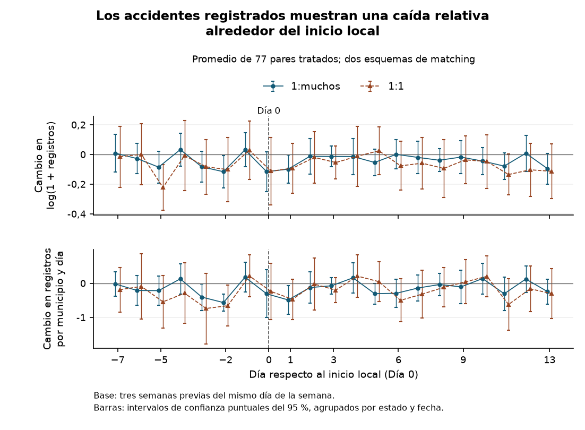

# Narcoataques y siniestros viales registrados

*Cambios en siniestros viales tras el inicio local de narcoataques en municipios mexicanos, 2019–2025*

**Eduardo Garcia Cortez · Clave única: 207480**

**Profesor: Mauricio Romero**

Inferencia Causal · ITAM · Noviembre de 2026

> Versión Markdown sincronizada con el [reporte en PDF](reporte.pdf). El PDF corresponde al contenido aprobado de esta nota.

## Resumen

Se estudian los accidentes registrados tras el inicio local de narcoataques en municipios mexicanos, 2019–2025. Se comparan cambios de municipios tratados con controles emparejados, respecto a tres semanas previas del mismo día de la semana. La muestra contiene 77 pares municipio–episodio y 32 fechas de inicio. En los Días 0–1, la estimación principal es -0,107 en $\log(1+Y)$, donde $Y$ cuenta accidentes registrados, con intervalo de confianza del 95 % de [-0,195; -0,019], agrupado por estado y fecha. La caída posterior es menor e incierta. Las diferencias previas entre grupos limitan la atribución causal.

## 1. Contexto y motivación

¿Cómo cambian los accidentes registrados tras el inicio local de narcoataques? La hipótesis es que los bloqueos y la suspensión del transporte reducen la circulación; los desvíos y los cambios al conducir pueden contrarrestar esa caída. La violencia contra transportistas de Chilpancingo en febrero de 2024 ilustra la interrupción del transporte público (Amapola Periodismo, 2024). Se utiliza la Estadística de Accidentes de Tránsito Terrestre en Zonas Urbanas y Suburbanas (ATUS), del Instituto Nacional de Estadística y Geografía (INEGI), que cubre vías no federales (2026a). Su conteo refleja accidentes y captación; no mide riesgo por viaje.

El objetivo es el efecto promedio del tratamiento entre los tratados (ATT): la diferencia entre los registros con y sin el inicio del ataque para los pares municipio–episodio incluidos, con igual peso para cada par. Se distinguen Días 0–1, Días 2–6 y Sem. +1 (Días 7–13). El Día 0 es la fecha del inicio local y puede incluir horas anteriores al ataque; Días 0–1 son dos días naturales, no necesariamente las primeras 48 horas.

Bauernschuster y Rekers (2022) encuentran una reducción de accidentes durante operativos alemanes de velocidad de un día, sin persistencia posterior detectable. Este antecedente motiva separar el cambio inmediato de su duración y revisar el calendario, aunque los mecanismos difieren de los narcoataques. Dell (2015) documenta desplazamientos de rutas del narcotráfico y de la violencia, lo que motiva examinar posibles efectos sobre los controles; no demuestra que hayan ocurrido en esta muestra.

## 2. Datos

### Accidentes y exposición.

Se utilizan los microdatos definitivos de ATUS de 2019–2025 y los últimos meses de 2018 para revisar la cobertura previa (Instituto Nacional de Estadística y Geografía, 2025a, 2026a). En 2019–2025 hay 2 518 436 registros con fecha válida. Se conservan filas con atributos repetidos porque ATUS no proporciona un identificador único de accidente.

La muestra principal contiene 3 613 pares municipio–fecha: 77 tratados y 3 536 controles. Reúne 54 municipios tratados y 765 de control, con posibles repeticiones entre grupos y fechas. Los 31 episodios tienen inicio local en 32 fechas, pues un episodio puede comenzar en fechas distintas según el municipio. Cada regresión utiliza una observación por par para el día o intervalo analizado.

Se identifica un episodio a partir de acciones coordinadas en al menos tres lugares dentro de 24 horas, con afectación del espacio público, comercios o transporte. Los lugares pueden pertenecer a municipios distintos. Para cada municipio se identifica el inicio local, aunque la violencia continúe después.

El catálogo es propio: tres subagentes de inteligencia artificial (IA) recopilaron prensa y comunicados oficiales que corroboran algunos casos. No es una base oficial consolidada ni una validación humana exhaustiva. La cobertura es desigual y persisten casos pendientes de corroboración. Los incidentes menores o inciertos sirven como antecedentes de exposición; los apéndices C y E detallan las exclusiones y la construcción del catálogo.

### Cobertura y ceros.

Se exige al menos un registro con fecha válida en cada uno de los tres meses completos anteriores al mes del inicio. La muestra principal se selecciona con información previa y no exige continuidad del registro después del ataque.

El resultado cuenta accidentes publicados con fecha válida. Un cero indica ausencia de registros para ese municipio y día; no distingue entre ausencia de accidentes, hechos sin registro o interrupciones de la captación. Los faltantes del panel de continuidad se conservan como faltantes.

### Covariables y territorio.

La población procede de la Encuesta Intercensal 2015 (EIC) y de los Principales resultados por localidad (ITER) del Censo 2020. El Sistema Automatizado de Información Censal (SAIC) aporta empleo de 2018 y 2023; Vehículos de Motor Registrados en Circulación (VMRC), automóviles de 2018–2024. Las tasas por mil habitantes usan población anual del Consejo Nacional de Población (CONAPO). El Catálogo Único de Claves de Áreas Geoestadísticas Estatales, Municipales y Localidades (AGEEML) permite revisar cambios territoriales (Consejo Nacional de Población, 2024; Instituto Nacional de Estadística y Geografía, 2015, 2021, 2025b, 2026c, 2026b).

Para cada inicio $t$, se selecciona por variable la medición más reciente anterior a $t-28$. Las ediciones consultadas son retrospectivas: la regla evita mediciones posteriores al ataque, pero no reproduce la información publicada en aquel momento.

Antes de exigir datos completos, el empleo y los automóviles se enlazan en 82 de los 84 pares tratados elegibles (97,6 % en cada fuente). Una fila enlazada puede contener valores inutilizables; el emparejamiento exige valores utilizables. El apéndice A presenta las tasas de todas las fuentes y los filtros que dejan 77 pares tratados.

**Cuadro 1.** Comparabilidad previa de la muestra final

| Variable | Tratados: media (DE) | Controles 1:muchos | DME 1:muchos | DME 1:1 |
|:---|---:|---:|---:|---:|
| Población | 229 998,60 (243 845,81) | 225 349,52 (281 538,21) | 0,013 | 0,005 |
| Empleo / mil | 206,96 (95,98) | 197,32 (90,33) | 0,070 | 0,027 |
| Autos / mil | 208,63 (87,90) | 219,93 (97,55) | -0,082 | -0,023 |
| Accidentes previos | 2,05 (3,41) | 2,09 (3,45) | -0,011 | 0,012 |

Desviación estándar (DE) ponderada entre pares. Las diferencias de medias estandarizadas (DME) utilizan como escala común la raíz del promedio de varianzas de ambos grupos de la referencia con calibre individual. El nivel previo es la media de $[-28,-15]$; su DE entre pares difiere de la DE de niveles diarios que estandariza los efectos.

## 3. Estrategia empírica

### Estimando y base.

Sea $t$ el inicio local, $D_{it}$ la asignación focal y $A_{it}$ la elegibilidad previa. Para $g(y)=\log(1+y)$, principal, o $g(y)=y$, complementaria, el objetivo es

$$
\tau_h^g=E[g(Y_{i,t+h}(1))-g(Y_{i,t+h}(0))\mid D_{it}=1,A_{it}=1,\text{soporte}].
$$

La muestra principal no se condiciona a la ausencia de violencia posterior. Se definen $q(h)=h\bmod7\in\{0,\ldots,6\}$, $r(t,h)=t+q(h)$ y

$$
B_{ith}^g=\tfrac13\sum_{k\in\{28,21,14\}}g(Y_{i,r(t,h)-k}),\qquad
\Delta_{ith}^g=g(Y_{i,t+h})-B_{ith}^g.
$$

Para cada día analizado, la base promedia tres fechas anteriores al inicio con el mismo día de la semana, entre los Días -28 y -8. La semana inmediatamente anterior queda fuera. Cada intervalo promedia los cambios diarios respecto a esa base.

En Culiacán, Sinaloa, el jueves 17 de octubre de 2019 se compara con los jueves 19 y 26 de septiembre y 3 de octubre. El jueves siguiente reutiliza esas referencias; la base siempre permanece antes del inicio.

Se aplica $\log(1+Y)$ a cada conteo antes de promediar: el uno incluye ceros y el logaritmo reduce la influencia de conteos altos. En niveles se utiliza el conteo directo. Cada escala requiere tendencias paralelas propias; la validez en una no demuestra validez en la otra.

### Comparadores y pesos.

Se excluyen municipios con exposición documentada entre los Días -49 y -1: la regla cubre la base y añade 21 días anteriores a su primera medición. Se supone que los ataques más antiguos ya no afectan la comparación.

Los controles proceden de estados ajenos al episodio. También se excluyen municipios con antecedentes documentados y estados con señales previas sin municipio identificable. Se exige estabilidad territorial desde el inicio de la base hasta la víspera del ataque. La selección principal no utiliza ataques posteriores.

El nivel previo es la media de los Días -28 a -15. Se exige $(\bar Y_c+0.5)/(\bar Y_i+0.5)\in[0.5,2]$, donde $\bar Y_i$ y $\bar Y_c$ son las medias del tratado y del candidato. La población, el empleo y los automóviles por mil habitantes también deben estar, por separado, entre la mitad y el doble del valor tratado. Se requieren al menos diez candidatos de cinco estados por tratado.

El matching 1:muchos utiliza todos los candidatos: cada tratado pesa uno y reparte otro peso total de uno entre sus controles. El matching 1:1 elige el candidato más cercano según población, empleo y automóviles, después de comprobar el mismo mínimo de candidatos y estados. Se permite reutilizar controles; sus pesos acumulan las contribuciones de cada tratado.

La regresión de diferencias en diferencias compara el cambio de cada municipio tratado respecto a su base previa con el cambio de sus controles en las mismas fechas. Se estima por mínimos cuadrados ponderados:

$$
\Delta_{ith}^{g}=\lambda_{th}+\beta_h^{g}D_{it}+X_{it}'\gamma_h+u_{ith}.
$$

Aquí, $i$ es el municipio; $t$, el inicio local; y $h$, el día o intervalo. $\Delta_{ith}^g$ es el cambio respecto a la base en la escala $g$. $D_{it}$ distingue tratados y controles; $\lambda_{th}$ recoge el cambio común de la fecha. $\beta_h^g$ compara los cambios de ambos grupos. $X_{it}$ contiene covariables previas, $\gamma_h$ sus coeficientes y $u_{ith}$ el residuo.

El modelo principal $M_0$ omite $X_{it}$ y promedia por igual las diferencias en diferencias de los tratados. $M_1$ añade logaritmo de población; $M_2$, empleo por mil habitantes; y $M_3$, automóviles por mil habitantes. Todos conservan muestra y pesos explícitos. Los modelos ajustados evalúan sensibilidad al ajuste lineal, cuya ponderación implícita puede diferir de la de $M_0$.

### Identificación y sesgo.

Supuestos no comprobables directamente: sin el ataque, tratados y controles habrían tenido cambios paralelos en la escala analizada; no habría anticipación en la base, efectos persistentes de ataques anteriores ni efectos de la violencia sobre los controles. El emparejamiento mejora la comparabilidad observada, pero no garantiza esos supuestos. Si fallan, el coeficiente puede incorporar diferencias ajenas al ataque. Los cambios de captación también limitan interpretar los registros como cambios de accidentes reales.

Comprobaciones con la información disponible: fechas, criterios de inclusión y pesos. Los resultados previos y el placebo permiten detectar problemas de comparación; no demostrar tendencias paralelas (Roth, 2022). Como los episodios pueden repetirse, no corresponde suponer automáticamente una adopción permanente del tratamiento (Dube et al., 2025).

### 3.1. Inferencia y separación de estimandos

Se utilizan errores estándar agrupados por estado para admitir dependencia entre municipios del mismo estado a lo largo del tiempo. Los intervalos principales añaden agrupación por fecha de inicio, que admite dependencia entre municipios con la misma fecha. La agrupación cambia la precisión, no el coeficiente ni la muestra.

De los 32 estados, 14 aportan tratados. Se revisa la concentración de peso mediante la omisión de cada estado por turno y un intervalo alternativo. El apéndice D detalla el cálculo y las correcciones por número de grupos (MacKinnon et al., 2023a, 2023b). Estas medidas no corrigen sesgo.

La duración se examina en la muestra principal. Como contraste, se exige continuidad del reporte entre los Días -28 y +13 y ausencia de otra exposición hasta +14; el episodio inicial puede continuar. Esta muestra depende de sucesos posteriores al ataque y puede incorporar selección, por lo que no se interpreta automáticamente como el mismo efecto causal.

## 4. Resultados

### Efecto inmediato y escala.

En los Días 0–1, $M_0$ con emparejamiento 1:muchos estima -0,107 en $\log(1+Y)$, con intervalo de confianza del 95 % de [-0,195; -0,019], agrupado por estado y fecha. Equivale a -0,130 desviaciones estándar diarias previas y a una caída aproximada del 10,2 % en la escala geométrica de $1+Y$, no directamente en el promedio de $Y$. El intervalo alternativo por omisión de estados también excluye cero.

En niveles, se estiman 0,397 registros menos por municipio y día, equivalentes a -0,108 desviaciones estándar; el intervalo [-0,865; 0,072] incluye cero. El efecto mínimo detectable (MDE) es de 0,664 registros, con prueba bilateral al 5 % y potencia del 80 %. El cambio nulo no queda demostrado. Estos resultados no distinguen circulación, conducta y captación.

Los contrastes y la estandarización se detallan en el cuadro B1 del apéndice B; el cálculo de potencia, en el apéndice D.

### Especificaciones progresivas.

El cuadro 2 muestra que el ajuste por población, empleo y automóviles cambia poco la estimación inmediata: los coeficientes se sitúan entre -0,105 y -0,108 en $\log(1+Y)$ y entre -0,381 y -0,401 registros por municipio y día.

Esta estabilidad no descarta factores omitidos ni garantiza tendencias paralelas. El Panel A presenta los resultados logarítmicos; el Panel B, en niveles, está en el apéndice A.

**Cuadro 2.** Días 0–1: regresiones con ajuste progresivo en la muestra principal

**Panel A. Resultado: cambio en $\log(1+Y)$**

| Variable / estadístico | $M_0$ | $M_1$ | $M_2$ | $M_3$ |
|:---|---:|---:|---:|---:|
| Tratamiento | -0,107 (0,043) [-0,195; -0,019] $p=0{,}019$ | -0,105 (0,043) [-0,194; -0,017] $p=0{,}021$ | -0,107 (0,043) [-0,195; -0,018] $p=0{,}020$ | -0,108 (0,045) [-0,200; -0,017] $p=0{,}022$ |
| Logaritmo de la población | — | -0,022 (0,019) [-0,061; 0,017] $p=0{,}261$ | -0,030 (0,029) [-0,088; 0,028] $p=0{,}303$ | -0,029 (0,028) [-0,085; 0,028] $p=0{,}309$ |
| Empleo por cada mil habitantes | — | — | 0,000184 (0,000399) [-0,000631; 0,000998] $p=0{,}649$ | 0,000214 (0,000434) [-0,000671; 0,001100] $p=0{,}625$ |
| Automóviles por cada mil habitantes | — | — | — | -0,000111 (0,000245) [-0,000612; 0,000389] $p=0{,}653$ |
| $R^2$ ponderado | 0,162 | 0,164 | 0,165 | 0,166 |
| $R^2$ tras descontar las fechas | 0,022 | 0,025 | 0,026 | 0,027 |

Cada celda presenta estimación, error estándar (EE), intervalo de confianza (IC) del 95 % y valor $p$ bilateral, con agrupación por estado y fecha y 31 grados de libertad. El guion indica una variable excluida. Las dos medidas de $R^2$ se explican en el apéndice A.

Emparejamiento 1:muchos: los cuatro modelos utilizan 3 613 observaciones municipio–fecha, 77 pares tratados, 32 fechas de inicio y efectos fijos de fecha. Conservan muestra, pesos y base de tres semanas. Los coeficientes de las covariables son ajustes estadísticos, no sus efectos causales.

### Trayectoria y falsificaciones.

La figura 1 muestra una caída alrededor del inicio, mayor en los Días 0–1. También aparecen diferencias previas: Sem. -1 tiene una estimación logarítmica de -0,034 [-0,079; 0,011], y los Días -2 y -5 presentan -0,116 y -0,085. Estas señales limitan la atribución al ataque. Los intervalos corresponden a cada punto, no a toda la trayectoria.

**Figura 1. Los accidentes registrados muestran una caída relativa alrededor del inicio local.** Modelo $M_0$, emparejamientos 1:muchos y 1:1. Día 0: inicio local. Base: tres fechas previas del mismo día de la semana. Arriba: cambio en $\log(1+Y)$; abajo: cambio en registros por municipio y día. Barras: intervalos puntuales del 95 %, agrupados por estado y fecha. La línea vertical marca el Día 0.

El contraste conjunto de las semanas -4, -3 y -1, respecto a la -2, rechaza diferencias previas nulas con agrupación estatal ($p<0{,}001$), pero no con agrupación por estado y fecha ($p=0{,}109$). El primer resultado señala diferencias que el emparejamiento no eliminó; el segundo no demuestra tendencias paralelas. Esta referencia sirve al diagnóstico y no sustituye la base principal (apéndice D).

El placebo reconstruye la muestra, el emparejamiento y la base con un inicio ficticio 28 días antes. En Días 0–1 estima -0,023 en logaritmos, con intervalo de [-0,087; 0,040], agrupado por estado y fecha. No reproduce una caída inmediata comparable, pero no prueba causalidad ni una diferencia formal entre coeficientes.

En periodos posteriores del placebo, algunos intervalos estatales excluyen cero, aunque los agrupados por estado y fecha lo incluyen. El ejercicio no descarta todos los cambios previos; el apéndice B presenta los contrastes completos.

### Persistencia y sensibilidades.

Las estimaciones logarítmicas son -0,018 en Días 2–6 y -0,041 en Sem. +1. Sus intervalos, agrupados por estado y fecha, incluyen cero; los efectos mínimos detectables, con una prueba bilateral al 5 % y potencia del 80 %, son 0,072 y 0,061, respectivamente. La menor magnitud estimada no prueba que el cambio desaparezca desde el Día 2. La señal de Sem. +1 depende de la agrupación y las exclusiones.

Con la semana inmediatamente anterior como base, y los mismos pares y pesos, Días 0–1 arroja -0,064 [-0,167; 0,039]. La menor magnitud y el intervalo que incluye cero muestran sensibilidad a la referencia. Los apéndices B y C detallan duración y bases alternativas.

### Calendario y controles.

Se excluyen inicios cuyo Día 0 o Día 1 coincide con feriados de la Ley Federal del Trabajo (LFT) o recesos de la Secretaría de Educación Pública (SEP), pues ambos pueden alterar la circulación (Cámara de Diputados, 2025; Secretaría de Educación de Veracruz, 2026).

La muestra se reduce de 77 a 25 pares tratados y de 32 a 15 fechas. La estimación logarítmica inmediata es -0,123 [-0,258; 0,011], con agrupación por estado y fecha. El intervalo incluye cero y cambia la composición de la muestra; la diferencia no se atribuye solo al calendario ni solo al menor tamaño. El apéndice C presenta las fechas y las exclusiones adicionales.

## 5. Conclusión y validez externa

Se documenta una reducción relativa inmediata de accidentes registrados: -0,107 en $\log(1+Y)$ durante los Días 0–1, con intervalo del 95 % de [-0,195; -0,019], agrupado por estado y fecha. El ajuste por covariables cambia poco la estimación; el placebo no reproduce una caída comparable. Después, las estimaciones son menores e inciertas, sin una fecha precisa de desaparición. El patrón es compatible con menos circulación, cambios al conducir o alteraciones de la captación; no identifica cada mecanismo ni demuestra menor riesgo por viaje.

El resultado promedia 77 pares municipio–episodio documentados en 2019–2025, con igual peso por tratado y registros de vías no federales. No representa cada ataque ni se extrapola automáticamente a otros incidentes o territorios. Las diferencias previas, la sensibilidad de la inferencia y la cobertura desigual del catálogo limitan la atribución causal. Para las autoridades, una caída de registros requiere contrastar movilidad, atención de emergencias y captación antes de interpretarla como una mejora de seguridad.

## Referencias

Amapola Periodismo. (2024, 8 de febrero). *Chilpancingo: tres días de parálisis por la violencia*. <https://amapolaperiodismo.com/2024/02/08/chilpancingo-tres-dias-de-paralisis-por-la-violencia/>

Bauernschuster, S., & Rekers, R. (2022). Speed limit enforcement and road safety. *Journal of Public Economics*, *210*, Artículo 104663. <https://doi.org/10.1016/j.jpubeco.2022.104663>

Cámara de Diputados. (2025). *Ley Federal del Trabajo, artículo 74*. <https://www.ordenjuridico.gob.mx/Documentos/Federal/html/wo125151.html>

Consejo Nacional de Población. (2024). *Reconstrucción y proyecciones de la población de los municipios de México, 1990–2040*. <https://conapo.segob.gob.mx/work/models/CONAPO/pry23/DBMun/00_Republica_mexicana.zip>

Dell, M. (2015). Trafficking networks and the Mexican Drug War. *American Economic Review*, *105*(6), 1738–1779. <https://doi.org/10.1257/aer.20121637>

Dube, A., Girardi, D., Jordà, Ò., & Taylor, A. M. (2025). A local projections approach to difference-in-differences. *Journal of Applied Econometrics*, *40*(7), 741–758. <https://doi.org/10.1002/jae.70000>

Instituto Nacional de Estadística y Geografía. (2015). *Encuesta Intercensal 2015: tabulados de población y vivienda*. <https://www.inegi.org.mx/programas/intercensal/2015/>

Instituto Nacional de Estadística y Geografía. (2021). *Censo de Población y Vivienda 2020: principales resultados por localidad (ITER)*. <https://www.inegi.org.mx/programas/ccpv/2020/>

Instituto Nacional de Estadística y Geografía. (2025a). *Estadística de Accidentes de Tránsito Terrestre en Zonas Urbanas y Suburbanas, diccionario de datos*. <https://inegi.org.mx/rnm/index.php/catalog/1115/data-dictionary/F1>

Instituto Nacional de Estadística y Geografía. (2025b). *Sistema Automatizado de Información Censal (SAIC)*. <https://www.inegi.org.mx/app/saic/>

Instituto Nacional de Estadística y Geografía. (2026a). *Accidentes de Tránsito Terrestre en Zonas Urbanas y Suburbanas*. <https://www.inegi.org.mx/programas/accidentes/>

Instituto Nacional de Estadística y Geografía. (2026b). *Catálogo Único de Claves de Áreas Geoestadísticas Estatales, Municipales y Localidades*. <https://www.inegi.org.mx/app/ageeml/>

Instituto Nacional de Estadística y Geografía. (2026c). *Vehículos de Motor Registrados en Circulación (VMRC)*. <https://www.inegi.org.mx/programas/vehiculosmotor/>

MacKinnon, J. G., Nielsen, M. Ø., & Webb, M. D. (2023a). Cluster-robust inference: A guide to empirical practice. *Journal of Econometrics*, *232*(2), 272–299. <https://doi.org/10.1016/j.jeconom.2022.04.001>

MacKinnon, J. G., Nielsen, M. Ø., & Webb, M. D. (2023b). Fast and reliable jackknife and bootstrap methods for cluster-robust inference. *Journal of Applied Econometrics*, *38*(5), 671–694. <https://doi.org/10.1002/jae.2969>

Roth, J. (2022). Pretest with caution: Event-study estimates after testing for parallel trends. *American Economic Review: Insights*, *4*(3), 305–322. <https://doi.org/10.1257/aeri.20210236>

Secretaría de Educación de Veracruz. (2026). *Calendarios escolares históricos de educación básica*. <https://www.sev.gob.mx/educacion-basica/calendario-escolar/>

## Apéndice A. Fuentes y especificaciones progresivas

### Regresiones complementarias en niveles.

**Panel B del cuadro 2. Resultado: cambio en el número de accidentes registrados**

| Variable / estadístico | $M_0$ | $M_1$ | $M_2$ | $M_3$ |
|:---|---:|---:|---:|---:|
| Tratamiento | -0,397 (0,230) [-0,865; 0,072] $p=0{,}094$ | -0,381 (0,230) [-0,849; 0,087] $p=0{,}107$ | -0,383 (0,236) [-0,864; 0,097] $p=0{,}114$ | -0,401 (0,241) [-0,893; 0,090] $p=0{,}106$ |
| Logaritmo de la población | — | -0,193 (0,106) [-0,410; 0,024] $p=0{,}079$ | -0,207 (0,129) [-0,470; 0,056] $p=0{,}119$ | -0,194 (0,121) [-0,441; 0,053] $p=0{,}119$ |
| Empleo por cada mil habitantes | — | — | 0,000327 (0,001345) [-0,002416; 0,003071] $p=0{,}809$ | 0,000656 (0,001396) [-0,002191; 0,003503] $p=0{,}642$ |
| Automóviles por cada mil habitantes | — | — | — | -0,001195 (0,001017) [-0,003268; 0,000878] $p=0{,}249$ |
| $R^2$ ponderado | 0,180 | 0,191 | 0,191 | 0,194 |
| $R^2$ tras descontar las fechas | 0,017 | 0,030 | 0,030 | 0,033 |

Cada celda presenta la estimación, el error estándar entre paréntesis, el intervalo de confianza del 95 % entre corchetes y el valor $p$ bilateral. La agrupación por estado y fecha utiliza 31 grados de libertad. Los cuatro modelos utilizan 3 613 observaciones municipio–fecha, 77 pares tratados y 32 fechas de inicio, e incluyen efectos fijos de fecha. Los pesos y la base previa son los mismos del Panel A.

Las dos medidas de $R^2$ del cuadro 2 y su Panel B resumen el ajuste de la regresión. La primera incluye los efectos fijos de fecha; la segunda mide el ajuste adicional del tratamiento y las covariables después de descontar las medias ponderadas de cada fecha. Ambas se calculan como $R^2=1-\mathrm{SCE}/\mathrm{SCT}$. La suma de cuadrados del error (SCE) utiliza residuos y pesos. La suma de cuadrados total (SCT) utiliza desviaciones respecto a la media ponderada general en la primera medida y respecto a las medias ponderadas de fecha en la segunda. Un $R^2$ mayor no demuestra validez causal.

### Detalles de medición y emparejamiento.

Colima requiere una precaución adicional: los automóviles de la serie etiquetada como 2023 tienen fecha de medición del 30 de abril de 2024 y usan población de 2024 como denominador. El valor solo es utilizable cuando tanto esa medición como la fecha del denominador, el 1 de julio de 2024, preceden a $t-28$. Los ceros, los valores confidenciales, los faltantes y las incompatibilidades territoriales se distinguen antes de elegir los controles.

En Morelia, Michoacán, para el inicio del 23 de abril de 2025 se seleccionan doce municipios de control. La cantidad resulta de los filtros de comparabilidad y no se fija de antemano. El nivel previo de accidentes registrados de cada candidato se compara con el nivel del municipio tratado.

### Fuentes y selección de la muestra.

**Cuadro A1.** Uniones antes del emparejamiento

| Fuente    |       Rol | Unidas / elegibles |     % | Valor utilizable / elegibles |
|:----------|----------:|-------------------:|------:|-----------------------------:|
| EIC 2015  |  Tratados |                7/7 | 100,0 |                          7/7 |
| ITER 2020 |  Tratados |              75/77 |  97,4 |                        75/77 |
| EIC 2015  | Controles |        3 411/3 453 |  98,8 |                  3 411/3 453 |
| ITER 2020 | Controles |      20 814/20 981 |  99,2 |                20 814/20 981 |
| SAIC      |  Tratados |              82/84 |  97,6 |                        82/84 |
| SAIC      | Controles |      24 230/24 434 |  99,2 |                24 139/24 434 |
| VMRC      |  Tratados |              82/84 |  97,6 |                        82/84 |
| VMRC      | Controles |      24 092/24 434 |  98,6 |                24 002/24 434 |

El universo son pares elegibles antes de exigir valores completos. Unión no equivale a valor utilizable. CONAPO corresponde al año del numerador. AGEEML es un inventario de cambios: no tener fila no es fallo de unión; se evalúa estabilidad territorial entre fechas.

**Cuadro A2.** Uniones auxiliares y territorio

| Operación | Numerador / denominador | % | Universo |
|:---|---:|---:|---:|
| CONAPO en SAIC | 3 613/3 613 | 100,0 | Pares de la muestra final |
| CONAPO en VMRC | 3 613/3 613 | 100,0 | Pares de la muestra final |
| AGEEML: perímetro estable | 106 554/106 554 | 100,0 | Municipio-fechas candidatos |

**Cuadro A3.** Pérdidas de tratados hasta la muestra principal

| Paso, orden jerárquico              | Trat. restantes | Trat. excluidos |
|:------------------------------------|----------------:|----------------:|
| Candidatos del catálogo             |             108 |               — |
| Sin historia de cobertura           |              94 |              14 |
| Exposición previa, tras cobertura   |              84 |              10 |
| Territorio, tras filtros anteriores |              84 |               0 |
| Covariables faltantes               |              82 |               2 |
| Controles completos insuficientes   |              82 |               0 |
| Calibre individual sin soporte      |              82 |               0 |
| Población sin soporte               |              78 |               4 |
| Empleo sin soporte                  |              77 |               1 |
| Autos sin soporte                   |              77 |               0 |

Cada fila cuenta pérdidas después de los filtros anteriores. Un fallo de soporte significa menos de diez candidatos o menos de cinco estados. La elegibilidad se construye hasta $t-1$; el soporte usa sólo covariables y niveles previos. Las exclusiones de persistencia se contabilizan aparte y no seleccionan el efecto inmediato principal. Los faltantes de covariables no se convierten en cero.

**Cuadro A4.** Días 0–1: $M_0$–$M_3$, muestra fija

| Controles | Modelo | Trat. | $N$ | $\log(1+Y)$, IC: estado y fecha | Niveles, IC: estado y fecha |
|:---|---:|---:|---:|---:|---:|
| Completos, calibre | Base ($M_0$) | 82 | 13 977 | -0,099 [-0,186; -0,012] | -0,426 [-0,893; 0,041] |
| Completos, calibre | $M_1$: + población | 82 | 13 977 | -0,097 [-0,182; -0,013] | -0,360 [-0,825; 0,104] |
| Completos, calibre | $M_2$: + empleo | 82 | 13 977 | -0,097 [-0,181; -0,012] | -0,362 [-0,816; 0,092] |
| Completos, calibre | $M_3$: + automóviles | 82 | 13 977 | -0,097 [-0,187; -0,007] | -0,379 [-0,851; 0,092] |
| Sin emparejar | Base ($M_0$) | 77 | 22 561 | -0,118 [-0,211; -0,025] | -0,458 [-0,921; 0,005] |
| Sin emparejar | $M_1$: + población | 77 | 22 561 | -0,095 [-0,173; -0,018] | -0,320 [-0,647; 0,006] |
| Sin emparejar | $M_2$: + empleo | 77 | 22 561 | -0,095 [-0,174; -0,017] | -0,320 [-0,648; 0,008] |
| Sin emparejar | $M_3$: + automóviles | 77 | 22 561 | -0,099 [-0,182; -0,015] | -0,343 [-0,697; 0,012] |
| 1:muchos | Base ($M_0$) | 77 | 3 613 | -0,107 [-0,195; -0,019] | -0,397 [-0,865; 0,072] |
| 1:muchos | $M_1$: + población | 77 | 3 613 | -0,105 [-0,194; -0,017] | -0,381 [-0,849; 0,087] |
| 1:muchos | $M_2$: + empleo | 77 | 3 613 | -0,107 [-0,195; -0,018] | -0,383 [-0,864; 0,097] |
| 1:muchos | $M_3$: + automóviles | 77 | 3 613 | -0,108 [-0,200; -0,017] | -0,401 [-0,893; 0,090] |
| 1:1 | Base ($M_0$) | 77 | 154 | -0,102 [-0,224; 0,019] | -0,353 [-0,905; 0,199] |
| 1:1 | $M_1$: + población | 77 | 154 | -0,102 [-0,227; 0,022] | -0,354 [-0,925; 0,217] |
| 1:1 | $M_2$: + empleo | 77 | 154 | -0,103 [-0,229; 0,023] | -0,362 [-0,942; 0,219] |
| 1:1 | $M_3$: + automóviles | 77 | 154 | -0,104 [-0,232; 0,025] | -0,375 [-0,971; 0,222] |

$M_0$: tratamiento y fecha; $M_1$: añade log población; $M_2$: empleo/mil; $M_3$: autos/mil. La muestra completa exige covariables utilizables y calibre individual, sin los tres intervalos adicionales del emparejamiento; conserva todos los tratados con ese soporte. Cada progresión usa exactamente sus mismos pares y pesos. La referencia sin emparejamiento mantiene los mismos tratados y controles completos, con pesos uniformes por fecha. Los dos esquemas comparten tratados, no controles. Las DME del cuadro 1 usan una escala común fijada antes del emparejamiento.

**Cuadro A5.** DME con los mismos tratados antes y después del emparejamiento

| Variable           | Antes de emparejar | 1:muchos |    1:1 |
|:-------------------|-------------------:|---------:|-------:|
| Población          |              0,274 |    0,013 |  0,005 |
| Empleo / mil       |              0,269 |    0,070 |  0,027 |
| Autos / mil        |             -0,021 |   -0,082 | -0,023 |
| Accidentes previos |              0,175 |   -0,011 |  0,012 |

La referencia previa incluye controles con datos completos y ponderación uniforme dentro de cada fecha. Las columnas posteriores cambian los vínculos y pesos, con los mismos tratados. La escala de estandarización es común, fijada en la referencia con calibre individual; una DME pequeña no demuestra balance de variables omitidas ni paralelismo. En niveles y log las covariables son las mismas, por lo que no se duplican estas estadísticas de balance.

## Apéndice B. Contrastes principales, persistencia y placebo

**Cuadro B1.** Contrastes principales, emparejamiento 1:muchos

| Escala | Tramo | $\hat\beta$ (EE) | IC 95 %: estado y fecha | $\beta/\sigma$ | MDE: estado y fecha |
|:---|---:|---:|---:|---:|---:|
| $\log(1+Y)$ | Día 0 | -0,116 (0,032) | [-0,251; 0,019] | -0,141 | 0,192 |
| $\log(1+Y)$ | Día 1 | -0,098 (0,026) | [-0,193; -0,003] | -0,119 | 0,135 |
| $\log(1+Y)$ | Días 0–1 | -0,107 (0,022) | [-0,195; -0,019] | -0,130 | 0,125 |
| $\log(1+Y)$ | Días 2–6 | -0,018 (0,015) | [-0,069; 0,032] | -0,022 | 0,072 |
| $\log(1+Y)$ | Sem. +1 | -0,041 (0,010) | [-0,084; 0,002] | -0,049 | 0,061 |
| Niveles | Día 0 | -0,306 (0,172) | [-1,006; 0,393] | -0,083 | 0,992 |
| Niveles | Día 1 | -0,487 (0,135) | [-0,911; -0,062] | -0,132 | 0,602 |
| Niveles | Días 0–1 | -0,397 (0,128) | [-0,865; 0,072] | -0,108 | 0,664 |
| Niveles | Días 2–6 | -0,126 (0,058) | [-0,336; 0,085] | -0,034 | 0,298 |
| Niveles | Sem. +1 | -0,079 (0,057) | [-0,317; 0,158] | -0,022 | 0,336 |

Los errores estándar (EE), entre paréntesis, se agrupan por estado. Los intervalos de confianza (IC) del 95 % se agrupan por estado y fecha; por eso no se calculan a partir de los EE entre paréntesis. El modelo $M_0$ utiliza 3 613 pares municipio–fecha. Los tramos son promedios diarios. La columna $\beta/\sigma$ divide el coeficiente por la desviación estándar diaria del resultado en $[-28,-8]$, calculada con divisor $n-1$; en niveles, esa desviación es de 3,68. El efecto mínimo detectable (MDE) se explica en el apéndice D.

**Cuadro B2.** Log: selección y horizontes, IC: estado y fecha

| Selección | Matching | Trat. | Días 0–1 | Días 2–6 | Sem. +1 |
|:---|---:|---:|---:|---:|---:|
| Principal | 1:muchos | 77 | -0,107 [-0,195; -0,019] | -0,018 [-0,069; 0,032] | -0,041 [-0,084; 0,002] |
| Principal | 1:1 | 77 | -0,102 [-0,224; 0,019] | -0,027 [-0,104; 0,050] | -0,084 [-0,168; 0,000] |
| Aislamiento posterior | 1:muchos | 69 | -0,124 [-0,220; -0,029] | -0,010 [-0,064; 0,044] | -0,045 [-0,092; 0,003] |
| Aislamiento posterior | 1:1 | 69 | -0,104 [-0,241; 0,033] | -0,024 [-0,107; 0,058] | -0,093 [-0,178; -0,008] |
| Placebo 28 días antes | 1:muchos | 81 | -0,023 [-0,087; 0,040] | -0,025 [-0,063; 0,012] | 0,010 [-0,025; 0,044] |
| Placebo 28 días antes | 1:1 | 81 | -0,059 [-0,153; 0,035] | -0,030 [-0,110; 0,051] | 0,008 [-0,055; 0,071] |

La muestra con aislamiento posterior exige cobertura $[-28,+13]$ y ausencia de otra exposición hasta +14. Sus diferencias incorporan selección posterior. El placebo reconstruye la muestra en $t-28$; sus tamaños no tienen que coincidir con los reales.

**Cuadro B3.** Placebo 28 días antes: efectos por periodo

| Escala | Horizonte | 1:muchos, IC: estado y fecha | $p_E$ | 1:1, IC: estado y fecha | $p_E$ |
|:---|---:|---:|---:|---:|---:|
| Log | Día 0 | -0,041 [-0,138; 0,056] | 0,248 | -0,078 [-0,225; 0,069] | 0,219 |
| Log | Día 1 | -0,006 [-0,110; 0,098] | 0,823 | -0,040 [-0,198; 0,118] | 0,473 |
| Log | Días 0–1 | -0,023 [-0,087; 0,040] | 0,333 | -0,059 [-0,153; 0,035] | 0,110 |
| Log | Días 2–6 | -0,025 [-0,063; 0,012] | 0,048 | -0,030 [-0,110; 0,051] | 0,365 |
| Log | Sem. 0 | -0,025 [-0,059; 0,010] | 0,068 | -0,038 [-0,098; 0,022] | 0,137 |
| Log | Sem. +1 | 0,010 [-0,025; 0,044] | 0,160 | 0,008 [-0,055; 0,071] | 0,752 |
| Niveles | Día 0 | -0,262 [-0,746; 0,222] | 0,097 | -0,395 [-1,132; 0,342] | 0,221 |
| Niveles | Día 1 | -0,023 [-0,423; 0,377] | 0,846 | -0,354 [-1,064; 0,357] | 0,238 |
| Niveles | Días 0–1 | -0,142 [-0,497; 0,212] | 0,226 | -0,374 [-0,944; 0,195] | 0,139 |
| Niveles | Días 2–6 | -0,156 [-0,364; 0,052] | 0,029 | -0,178 [-0,543; 0,187] | 0,233 |
| Niveles | Sem. 0 | -0,152 [-0,328; 0,023] | 0,022 | -0,234 [-0,509; 0,041] | 0,061 |
| Niveles | Sem. +1 | -0,032 [-0,148; 0,085] | 0,397 | -0,059 [-0,282; 0,164] | 0,584 |

$p_E$ corresponde a CRV1 estatal; los intervalos se agrupan por estado y fecha. Los rechazos estatales en tramos posteriores impiden describir todos los placebos como ceros limpios. Se exportan inicio real, índice ficticio, resultado y las tres fechas de base en `data/outputs/modelos/causal_fechas_base.csv`. También se publican días individuales -7 a -1 y 0 a 13 y la sensibilidad con base semana -1 en exactamente la misma muestra final. Los diagnósticos y las referencias alternativas se presentan sin seleccionar sus resultados según la significancia.

## Apéndice C. Sensibilidades y calendario

**Cuadro C1.** Días 0–1: exclusiones, IC: estado y fecha

| Exclusión / muestra | Matching | Trat. | Fechas | Log, IC: estado y fecha | Niveles, IC: estado y fecha |
|:---|---:|---:|---:|---:|---:|
| Principal | 1:muchos | 77 | 32 | -0,107 [-0,195; -0,019] | -0,397 [-0,865; 0,072] |
| Principal | 1:1 | 77 | 32 | -0,102 [-0,224; 0,019] | -0,353 [-0,905; 0,199] |
| Cinco fechas de auditoría | 1:muchos | 56 | 27 | -0,128 [-0,217; -0,039] | -0,504 [-0,875; -0,133] |
| Cinco fechas de auditoría | 1:1 | 56 | 27 | -0,136 [-0,283; 0,010] | -0,551 [-0,968; -0,134] |
| Sin feriados LFT | 1:muchos | 73 | 30 | -0,121 [-0,216; -0,026] | -0,486 [-0,988; 0,016] |
| Sin feriados LFT | 1:1 | 73 | 30 | -0,099 [-0,227; 0,029] | -0,340 [-0,921; 0,241] |
| Sin LFT ni recesos SEP | 1:muchos | 25 | 15 | -0,123 [-0,258; 0,011] | -0,585 [-1,160; -0,011] |
| Sin LFT ni recesos SEP | 1:1 | 25 | 15 | -0,123 [-0,404; 0,158] | -0,607 [-1,394; 0,181] |
| Sin dos tratados pendientes | 1:muchos | 75 | 32 | -0,109 [-0,199; -0,018] | -0,405 [-0,882; 0,071] |
| Sin dos tratados pendientes | 1:1 | 75 | 32 | -0,103 [-0,229; 0,022] | -0,360 [-0,925; 0,205] |
| Sin cuatro casos pendientes | 1:muchos | 74 | 32 | -0,108 [-0,200; -0,017] | -0,407 [-0,890; 0,075] |
| Sin cuatro casos pendientes | 1:1 | 74 | 32 | -0,099 [-0,225; 0,028] | -0,356 [-0,927; 0,216] |
| Sin dos señales en controles | 1:muchos | 77 | 32 | -0,107 [-0,196; -0,019] | -0,397 [-0,865; 0,071] |
| Sin dos señales en controles | 1:1 | 77 | 32 | -0,100 [-0,223; 0,023] | -0,344 [-0,901; 0,213] |

Las cinco fechas son 31/12/2019, 05/01/2023, 09/04/2023, 07/01/2024 y 23/04/2025. La regla amplia se aplica al día 0 o 1 sin eliminar automáticamente domingos. Se distinguen vacaciones, talleres, suspensiones y receso extraordinario de 2020; no se llama vacaciones a toda la educación a distancia.

Se excluyen por separado dos municipios de Michoacán: Chilchota (14/07/2021) y Contepec (23/04/2025). Se añade excluir los cuatro casos pendientes: también Huaniqueo, Michoacán (23/04/2025), y San Fernando, Tamaulipas (30/04/2023). San Fernando entra en la muestra principal; Huaniqueo sigue fuera por elegibilidad previa. Las señales son Centro, Tabasco (01–02/04/2025), y Coatzacoalcos, Veracruz (20/08/2022). Se elimina su contribución si intersecta $[t-49,t+14]$ y se reconstruyen emparejamiento y pesos. Coatzacoalcos ocurrió después del 09/08/2022: es una sensibilidad ex post explícita, no un filtro del principal. El cotejo anterior cubrió 27 pares de cuatro fechas. ACLED devolvió HTTP 403: no existe verificación exhaustiva y una búsqueda sin señal no demuestra ausencia.

**Cuadro C2.** Soporte de los escenarios

| Escenario                    |   Matching | Trat. | Cont. | Fechas | Episodios |
|:-----------------------------|---------:|------:|------:|-------:|----------:|
| Principal                    | 1:muchos |    77 | 3 536 |     32 |        31 |
| Principal                    |      1:1 |    77 |    77 |     32 |        31 |
| Aislamiento posterior        | 1:muchos |    69 | 3 038 |     30 |        29 |
| Aislamiento posterior        |      1:1 |    69 |    69 |     30 |        29 |
| Placebo 28 días antes        | 1:muchos |    81 | 3 838 |     38 |        37 |
| Placebo 28 días antes        |      1:1 |    81 |    81 |     38 |        37 |
| Cinco fechas de auditoría    | 1:muchos |    56 | 2 842 |     27 |        26 |
| Cinco fechas de auditoría    |      1:1 |    56 |    56 |     27 |        26 |
| Sin feriados LFT             | 1:muchos |    73 | 3 320 |     30 |        29 |
| Sin feriados LFT             |      1:1 |    73 |    73 |     30 |        29 |
| Sin LFT ni recesos SEP       | 1:muchos |    25 | 1 314 |     15 |        15 |
| Sin LFT ni recesos SEP       |      1:1 |    25 |    25 |     15 |        15 |
| Sin dos tratados pendientes  | 1:muchos |    75 | 3 457 |     32 |        31 |
| Sin dos tratados pendientes  |      1:1 |    75 |    75 |     32 |        31 |
| Sin cuatro casos pendientes  | 1:muchos |    74 | 3 283 |     32 |        31 |
| Sin cuatro casos pendientes  |      1:1 |    74 |    74 |     32 |        31 |
| Sin dos señales en controles | 1:muchos |    77 | 3 533 |     32 |        31 |
| Sin dos señales en controles |      1:1 |    77 |    77 |     32 |        31 |

**Cuadro C3.** Cohortes finales y calendario oficial

| Inicio     | Trat. | LFT en días 0–1 | SEP en días 0–1 | Cinco fechas |
|:-----------|------:|----------------:|----------------:|-------------:|
| 2019-10-17 |     1 |              No |              No |           No |
| 2019-11-30 |     1 |              No |              No |           No |
| 2019-12-31 |     1 |              Sí |              Sí |           Sí |
| 2020-03-10 |     3 |              No |              No |           No |
| 2020-06-19 |     1 |              No |              Sí |           No |
| 2020-06-20 |     5 |              No |              Sí |           No |
| 2020-12-04 |     1 |              No |              No |           No |
| 2021-05-28 |     2 |              No |              No |           No |
| 2021-07-14 |     2 |              No |              Sí |           No |
| 2022-03-13 |     1 |              No |              No |           No |
| 2022-08-09 |     5 |              No |              Sí |           No |
| 2022-08-10 |     1 |              No |              Sí |           No |
| 2022-08-12 |     2 |              No |              Sí |           No |
| 2022-08-18 |     1 |              No |              Sí |           No |
| 2022-08-27 |     2 |              No |              Sí |           No |
| 2022-11-28 |     1 |              No |              No |           No |
| 2022-12-04 |     2 |              No |              No |           No |
| 2023-01-05 |     3 |              No |              Sí |           Sí |
| 2023-02-19 |     1 |              No |              No |           No |
| 2023-04-09 |     2 |              No |              Sí |           Sí |
| 2023-04-30 |     3 |              Sí |              No |           No |
| 2023-08-27 |     3 |              No |              Sí |           No |
| 2023-09-22 |     1 |              No |              No |           No |
| 2023-09-27 |     2 |              No |              No |           No |
| 2023-12-22 |     1 |              No |              Sí |           No |
| 2024-01-07 |     5 |              No |              Sí |           Sí |
| 2024-05-05 |     1 |              No |              No |           No |
| 2024-10-04 |     3 |              No |              No |           No |
| 2025-04-23 |    10 |              No |              Sí |           Sí |
| 2025-07-26 |     5 |              No |              Sí |           No |
| 2025-09-28 |     1 |              No |              No |           No |
| 2025-10-03 |     4 |              No |              No |           No |

El calendario es nacional de educación básica, con fines de semana contiguos hasta la reanudación. No representa cada institución o adaptación estatal. La LFT sigue el artículo 74, incluido el cambio presidencial de 2024. Ninguna cohorte estimada coincide en días 0–1 con una jornada electoral ordinaria.

### Sensibilidad a la base de comparación

El cuadro C4 mantiene exactamente los mismos pares municipio–fecha y pesos, y cambia únicamente la referencia previa. Compara el Día -2, la base principal de tres semanas del mismo día de la semana y la semana inmediatamente anterior. Las diferencias entre columnas permiten observar cuánto depende el resultado de esa elección.

**Cuadro C4.** Días 0–1 con idénticos pares y pesos: base e IC agrupados por estado y fecha

| Matching | Escala | Día -2 | Tres semanas | Sem. -1 |
|:---|---:|---:|---:|---:|
| 1:muchos | Log | 0,013 [-0,074; 0,100] | -0,107 [-0,195; -0,019] | -0,064 [-0,167; 0,039] |
| 1:muchos | Niveles | 0,185 [-0,296; 0,666] | -0,397 [-0,865; 0,072] | -0,191 [-0,725; 0,343] |
| 1:1 | Log | -0,004 [-0,146; 0,138] | -0,102 [-0,224; 0,019] | -0,039 [-0,136; 0,058] |
| 1:1 | Niveles | 0,299 [-0,395; 0,992] | -0,353 [-0,905; 0,199] | 0,015 [-0,597; 0,626] |

## Apéndice D. Inferencia y potencia

Los errores agrupados por estado utilizan una estimación de varianza robusta por grupos, identificada como CRV1. Su corrección por tamaño de muestra es $\frac{G}{G-1}\frac{N-1}{N-K}$, donde $G$ es el número de estados, $N$ el número de pares municipio–fecha y $K$ el número de parámetros, incluidos los efectos de fecha. Los intervalos utilizan $G-1$ grados de libertad. En la agrupación por estado y fecha se suman los componentes de estado y fecha y se resta su intersección; la corrección y los grados de libertad utilizan el menor número de grupos. Este cálculo no permite cualquier dependencia entre estados en fechas distintas. Las varianzas indefinidas se señalan sin producir intervalos.

La alternativa CRV3 omite cada estado por turno, mantiene los pesos de los casos restantes y vuelve a estimar los efectos de fecha. Si $\hat\beta$ es el coeficiente con la muestra completa y $\hat\beta_{-g}$ el coeficiente sin el estado $g$, su varianza es

$$
\widehat V_{\mathrm{CRV3}}=\frac{G-1}{G}\sum_{g=1}^{G}(\hat\beta_{-g}-\hat\beta)^2.
$$

El cálculo se centra en el coeficiente completo y difiere de una variante centrada en la media de las estimaciones por omisión (MacKinnon et al., 2023a, 2023b).

### Efecto mínimo detectable.

El efecto mínimo detectable (MDE) es la magnitud que la prueba detectaría con una probabilidad del 80 %, bajo los supuestos del cálculo. Se utiliza una prueba bilateral al 5 %, errores estándar fijos y una distribución $t$ no central. En niveles, los umbrales de la especificación principal del cuadro D1 equivalen al 18,0 % de la media previa con agrupación estatal y al 32,4 % con agrupación por estado y fecha; esa media es de 2,05 registros por municipio y día. Los umbrales en $\log(1+Y)$ no son porcentajes directos del promedio de accidentes. Estas medidas de potencia condicional no corrigen sesgo ni demuestran equivalencia con cero.

**Cuadro D1.** Días 0–1: agrupamiento, CRV3 y MDE

| Matching   |  Escala |   Inferencia |          Días 0–1, IC 95% |  gl |   MDE |
|:---------|--------:|-------------:|--------------------------:|----:|------:|
| 1:muchos |     Log | CRV1 estatal | -0,107 [-0,152; -0,062] |  31 | 0,064 |
| 1:muchos |     Log |   CRV1: estado y fecha | -0,107 [-0,195; -0,019] |  31 | 0,125 |
| 1:muchos |     Log | CRV3 estatal | -0,107 [-0,199; -0,015] |  31 | 0,130 |
| 1:muchos | Niveles | CRV1 estatal | -0,397 [-0,657; -0,136] |  31 | 0,370 |
| 1:muchos | Niveles |   CRV1: estado y fecha |  -0,397 [-0,865; 0,072] |  31 | 0,664 |
| 1:muchos | Niveles | CRV3 estatal |  -0,397 [-0,925; 0,132] |  31 | 0,749 |
| 1:1      |     Log | CRV1 estatal | -0,102 [-0,182; -0,023] |  27 | 0,113 |
| 1:1      |     Log |   CRV1: estado y fecha |  -0,102 [-0,224; 0,019] |  27 | 0,172 |
| 1:1      |     Log | CRV3 estatal |  -0,102 [-0,221; 0,017] |  27 | 0,169 |
| 1:1      | Niveles | CRV1 estatal |  -0,353 [-0,770; 0,065] |  27 | 0,591 |
| 1:1      | Niveles |   CRV1: estado y fecha |  -0,353 [-0,905; 0,199] |  27 | 0,781 |
| 1:1      | Niveles | CRV3 estatal |  -0,353 [-0,934; 0,229] |  27 | 0,823 |

**Cuadro D2.** Wald semanal de tres restricciones

| Matching   |  Escala | Agrupación |     F |            p | Rango | Condición |   Cálculo |
|:---------|--------:|-----------:|------:|-------------:|------:|----------:|----------:|
| 1:muchos |     Log |    Estatal | 8,841 | $<0{,}001$ |     3 |      21,6 | calculada |
| 1:muchos |     Log |      Estado y fecha | 2,189 |        0,109 |     3 |       8,0 | calculada |
| 1:muchos | Niveles |    Estatal | 3,238 |        0,035 |     3 |      11,2 | calculada |
| 1:muchos | Niveles |      Estado y fecha | 2,459 |        0,081 |     3 |      12,4 | calculada |
| 1:1      |     Log |    Estatal | 1,385 |        0,269 |     3 |       5,4 | calculada |
| 1:1      |     Log |      Estado y fecha | 1,340 |        0,282 |     3 |       6,6 | calculada |
| 1:1      | Niveles |    Estatal | 1,369 |        0,273 |     3 |      14,3 | calculada |
| 1:1      | Niveles |      Estado y fecha | 1,043 |        0,389 |     3 |      15,0 | calculada |

Se omite semana -2 y se contrastan -4, -3 y -1. Se informa singularidad o indefinición sin usar una inversa generalizada para fabricar $p$. CRV3 tampoco repara anticipación, selección o interferencia.

**Cuadro D3.** Omisión de estados, $M_0$ y 1:muchos

| Estado omitido      | Log, días 0–1 | Niveles, días 0–1 |
|:--------------------|--------------:|------------------:|
| Aguascalientes      |        -0,121 |            -0,371 |
| Baja California     |        -0,100 |            -0,383 |
| Baja California Sur |        -0,106 |            -0,389 |
| Campeche            |        -0,109 |            -0,401 |
| Coahuila            |        -0,106 |            -0,395 |
| Colima              |        -0,109 |            -0,395 |
| Chiapas             |        -0,105 |            -0,392 |
| Chihuahua           |        -0,107 |            -0,403 |
| Ciudad de México    |        -0,109 |            -0,404 |
| Durango             |        -0,106 |            -0,395 |
| Guanajuato          |        -0,106 |            -0,412 |
| Guerrero            |        -0,105 |            -0,382 |
| Hidalgo             |        -0,107 |            -0,397 |
| Jalisco             |        -0,108 |            -0,399 |
| Estado de México    |        -0,103 |            -0,367 |
| Michoacán           |        -0,134 |            -0,560 |
| Morelos             |        -0,104 |            -0,390 |
| Nayarit             |        -0,115 |            -0,409 |
| Nuevo León          |        -0,118 |            -0,440 |
| Oaxaca              |        -0,108 |            -0,395 |
| Puebla              |        -0,108 |            -0,400 |
| Querétaro           |        -0,106 |            -0,391 |
| Quintana Roo        |        -0,109 |            -0,413 |
| San Luis Potosí     |        -0,109 |            -0,406 |
| Sinaloa             |        -0,079 |            -0,206 |
| Sonora              |        -0,109 |            -0,420 |
| Tabasco             |        -0,102 |            -0,375 |
| Tamaulipas          |        -0,100 |            -0,419 |
| Tlaxcala            |        -0,107 |            -0,397 |
| Veracruz            |        -0,107 |            -0,392 |
| Yucatán             |        -0,106 |            -0,391 |
| Zacatecas           |        -0,101 |            -0,399 |

Las réplicas mantienen pesos originales y vuelven a absorber las fechas. No se fuerza igualdad de masas después de omitir un estado: renormalizar o repetir el emparejamiento sería otro estimador, no el CRV3 anunciado. Se exportan 1:1 y $M_1$–$M_3$.

## Apéndice E. Construcción del catálogo y reproducción

### Catálogo de ataques.

Las búsquedas originales cubrieron tres regiones (norte, occidente y centro, sur y oriente) y tres periodos (2019–2021, 2022–2023 y 2024–2025). Tres subagentes de IA registraron consultas, enlaces, fechas de publicación y consulta, lugares y evidencia; los cotejos entre agentes examinaron casos de regiones distintas. Se buscaron dos orígenes informativos independientes para corroborar municipio y fecha: republicar un mismo boletín no constituye otra fuente. Una jornada que cruza medianoche puede tener fechas municipales distintas. Las discrepancias y corroboraciones pendientes se conservan en el catálogo.

Se utilizó el modelo «Sol 6.2», con la configuración «xhigh» y el modo «fast». Las bitácoras documentan las búsquedas y los cotejos, pero no registran la configuración del modelo.

Los cotejos documentados corresponden a agentes de IA; no se presentan como una validación humana exhaustiva. La prensa puede omitir episodios y una búsqueda sin hallazgos no acredita ausencia de ataques en los controles. Esta asistencia se usó para construir el catálogo de exposición, no para generar registros de accidentes ni covariables municipales, que provienen de las fuentes oficiales descritas en la sección 2.

### Reproducción del análisis.

El paquete `src/choques/`, configuración y pruebas acompañan al escrito. `README.md` documenta Python 3.13.2, dependencias y compilador. ATUS y los cien originales municipales deben corresponder a sus manifiestos: una edición nueva en la misma URL no los sustituye. Las entradas son `data/inputs/episodios.csv` y `data/inputs/fuentes_eventos.csv`, reconstruidas desde las hojas de evidencia. Las rutas parten de la carpeta que contiene `repo/`, `data/` y `tasks/`.

La interfaz de comandos ejecuta `validar`, `todo` y `compilar`. `python reproducir.py` crea otra copia, verifica originales, reconstruye ocho etapas y exige igualdad SHA-256 de todos los productos y del PDF. Las pruebas unitarias y sintéticas cubren calibre heterogéneo, base limpia, log con ceros, invariancia al futuro, territorio, pesos e inferencia con reestimación de fechas. Los tiempos de ejecución se registran aparte de los resultados. El registro de verificación distingue la reproducción del análisis de las revisiones editoriales del PDF.

Los datos públicos se enlazan en la bibliografía y los manifiestos fijan sus ediciones.

## Apéndice F. Contexto geográfico de la muestra

**Figura 2.** Municipios tratados y controles de la muestra principal. Naranja: 54 municipios tratados; azul: 765 municipios de control. Un municipio puede aparecer en ambos grupos en fechas distintas: ocurre en 47 casos. El gris indica que no pertenece al grupo de ese panel. El color muestra participación, no tamaño del efecto ni peso estadístico.

El mapa reúne las 32 fechas de inicio entre octubre de 2019 y octubre de 2025; los conteos únicos difieren de los 77 pares tratados y 3 536 pares de control municipio–fecha. Entre los lugares tratados están Culiacán, Sinaloa; Morelia, Michoacán; y Reynosa, Tamaulipas. Tijuana, Baja California, aparece en el grupo de control. La cartografía de referencia procede del Marco Geoestadístico del INEGI, diciembre de 2025, y del servicio del catálogo municipal. Sirve para ubicar los municipios; no reconstruye sus límites históricos ni representa riesgo por superficie. Se usa una proyección equirectangular con paralelo de referencia en 23 grados norte, sin calcular áreas o distancias.

## Apéndice G. Análisis exploratorio por horario y gravedad

El cuadro G1 compara, por gravedad, el cambio de accidentes registrados de noche con el de día en los Días 0–1 de la muestra principal. Se define el día de 06:00 a 17:59 y la noche de 18:00 a 05:59. Cada cifra resta dos cambios estimados, no los conteos nocturnos y diurnos. Un valor negativo indica una reducción relativa mayor de noche, o un aumento menor; uno positivo indica lo contrario.

En el emparejamiento 1:muchos, los tres intervalos de confianza incluyen cero. Ambos esquemas de matching tampoco muestran un patrón uniforme por gravedad. El ejercicio no permite atribuir la reducción agregada a una franja horaria ni a una conducta específica. Los registros con hora desconocida permanecen en el total. No se ajusta la inferencia por las comparaciones múltiples, por lo que los resultados son exploratorios.

**Cuadro G1.** Días 0–1: noche menos día por gravedad

| Gravedad    | 1:muchos: noche menos día |     1:1: noche menos día |
|:------------|--------------------------:|-------------------------:|
| Fatal       |  -0,024 [-0,055; 0,007] | -0,039 [-0,078; 0,000] |
| Con heridos |   0,089 [-0,019; 0,197] |  0,041 [-0,135; 0,217] |
| Solo daños  |  -0,051 [-0,256; 0,154] |  0,000 [-0,292; 0,292] |

Registros por municipio y día; IC del 95 % agrupados por estado y fecha.
